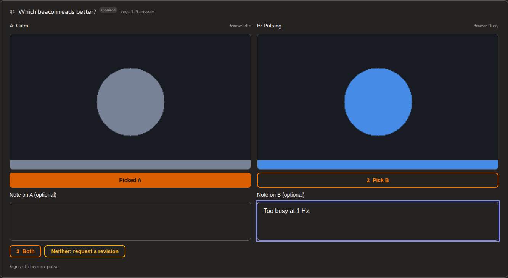

# titan-console

One read-only console over four local sources: the active-work daemon, the agent-chat broker,
the session graph and titan-factory's `needs.list`. It is one app shell built from `@titan-design/react-ui`, and one
loopback daemon built from `@titan-design/daemon` and `@titan-design/registry`. The browser
talks only to that daemon, through `@titan-design/react-app` hooks typed from the daemon's own
command definitions. The app is private and publishes nothing.

The skeleton (TP-842) serves the shell, hash routes and a rail of six (TP-1057). The
first real view is Initiatives (TP-861): the portfolio and one initiative's detail, read from
the active-work daemon. Home (TP-1061) reads upstream health, the portfolio, `work.tasks`, `agents.roster`,
`agents.queue` and `sessions.list`, and links each queue item out to agent-chat. Agents
(TP-864a, TP-865a) shows the roster, `agents.graph` (TP-847) and `agents.messages` (TP-1059).
Every other view is a placeholder that names the task that builds it.

## Run it

```sh
pnpm install --frozen-lockfile
pnpm --filter "titan-console..." build     # the app, its bin, and the workspace packages they import
pnpm --filter titan-console serve          # http://127.0.0.1:7500/
```

| Mode | How | What runs |
| --- | --- | --- |
| Dev | `pnpm --filter titan-console dev` | Vite on :5173 proxies `/rpc` to the console daemon on :7500 |
| Served | `pnpm --filter titan-console serve`, or `node apps/console/dist/cli.js` (the `titan-console` bin) | The daemon serves the single-file build through `mountStaticApp` beside `/rpc` |
| From disk | `pnpm --filter titan-console export` | Writes `dist/console.html` with its first-paint answers embedded by `embedSnapshot`; open it with no daemon. It records the status and the portfolio, with no personal initiative |
| Twin captures | `pnpm --filter titan-console capture` | Builds the page, renders every route from the typed twin fixtures with no daemon, and writes PNGs to `dist/twin`; see [Twin captures](#twin-captures) |

`serve` prints the address, and the LAN address too in LAN mode, and answers until SIGINT or SIGTERM:

```
titan console: http://127.0.0.1:7500/ (pid 4242)
titan console on the LAN: https://lan-box.example.ts.net:7500/ (sign in with `titan-console login-link`)
```

## Ports and settings

The console listens on **7500**, on loopback only unless LAN mode is on (see below). It never uses 7400, because the active-work
daemon and `titan-miner serve` both default to it. It refuses to start on a port that one of
its upstreams uses, and on a port value that is not a number.

| Variable | Default | Meaning |
| --- | --- | --- |
| `TITAN_CONSOLE_PORT` | `7500` | The console daemon's own port |
| `TITAN_CONSOLE_STORY_PORT` | `7501` | The story origin's port, which serves review rounds' stored Storybook builds (see "The story origin"). `0` turns it off. Refused if it equals the console's own port or an upstream's |
| `TITAN_CONSOLE_STATE` | `~/.local/state/titan-console` | Holds the daemon's pid file; a second console over the same directory is refused |
| `TITAN_CONSOLE_ACTIVE_WORK_PORT` | `7400` | Loopback port of the active-work daemon |
| `TITAN_CONSOLE_AGENT_CHAT_PORT` | `7600` | Loopback port of the agent-chat broker |
| `TITAN_CONSOLE_FACTORY_PORT` | `7410` | Loopback port of `titan-factory serve`, whose `needs.list` `approvals.flow` reads with no token, only the `X-Titan-Client` header. Refused if it equals the console's own port |
| `TITAN_CONSOLE_AGENT_CHAT_TOKEN` | `$AGENT_CHAT_HOME/ui.token`, else `~/.agent-chat/ui.token` | The broker's 0600 token file, read on every agents call and refused (exit 78) if group or others have any access |
| `TITAN_CONSOLE_EVENTS_DB` | `$AGENT_CHAT_HOME/events.db`, else `~/.agent-chat/events.db` | agent-chat's event log, opened read-only by `agents.messages`; when it will not open, that command falls back to the broker's history window |
| `TITAN_CONSOLE_AGENT_CHAT_BIN` | `agent-chat` on the service's `PATH` | the agent-chat CLI that tells a seat its decision round was answered (`agent-chat debug send`); a send that fails is retried when the console next starts |
| `TITAN_CONSOLE_EXPLAINER_BIN` | `explainer` on the service's `PATH` | the explainer CLI the theater's beat editor reads through (`explainer props`, `explainer edit check`); not found, the editor shows a gap line instead; a relative path gets its own "must be an absolute path" gap |
| `TITAN_CONSOLE_SEATS` | none | `seat=prefix` pairs, comma separated; an agent named `<prefix>-...` belongs to that seat |
| `TITAN_CONSOLE_SESSION_GRAPH` | `<active-work root>/.miner/graph.sqlite3` | Path of the session graph file |
| `TITAN_CONSOLE_HOST` | none | Turns LAN mode on: one IP address on this machine's interfaces, such as its tailscale address, served over HTTPS behind auth. Loopback, a wildcard, a name or an address the machine does not have is refused |
| `TITAN_CONSOLE_LAN_NAMES` | the hostname and `<hostname>.local` | Comma list of DNS names the LAN listener answers to; the first goes into login links. Set it to the tailnet name: the certificate must cover every name, so the defaults fail start. A port, an IP or a loopback name is refused |
| `TITAN_CONSOLE_TLS_CERT` | none | PEM certificate the LAN listener serves, such as the `.crt` from `tailscale cert`. Required with `TITAN_CONSOLE_HOST`; set with `_KEY` or not at all |
| `TITAN_CONSOLE_TLS_KEY` | none | Its PEM key; refused unless it is this user's and mode 0600. Both files are re-read within a minute of a change |
| `TITAN_CONSOLE_TOKEN` | `$TITAN_CONSOLE_STATE/lan.token` | The LAN secret, created at 0600 on first use; refused if it is group- or world-readable, a symlink, short or someone else's |
| `TITAN_CONSOLE_OWNER_WRITES` | `0` | `1` lets owner-write commands run on the LAN (see "Who may run a command"). Turning it on is an owner step. Any value but `0` or `1` is refused |
| `TITAN_CONSOLE_INBOX_DIR` | `$TITAN_CONSOLE_STATE/inbox/deposits` | The owner-inbox spool `inbox.deposit` files into, created 0700 on the first deposit |
| `TITAN_CONSOLE_ROUNDS_DIR` | `$TITAN_CONSOLE_STATE/rounds` | Review rounds, one `<round-id>/round.json` each, read by `rounds.list`, `rounds.get` and `approvals.flow`. `fixtures/rounds` holds synthetic ones for a browser check |
| `TITAN_CONSOLE_AUTONOMY_DIR` | none | The autonomy tree `config.surfaces` reads `charter.md` and `seats/*.md` from, and the tree `config.compareTree` imports; unset, `config.surfaces` answers a gap for them and `config.compareTree` answers `not-configured`. It must be an absolute or `~/` path. `burndown.config.json` and `seat-watchdog.json` are read from `$AGENT_CHAT_HOME`, else `~/.agent-chat`. Only fields each surface's allowlist in `server/config-surfaces/catalog.ts` names carry a value |
| `TITAN_CONSOLE_VIDEO_ROOTS` | none | Directories the theater lists `.mp4` and `.webm` renders from, joined with `:` (`;` on Windows), such as `$HOME/<data-dir>`. Walked to depth 8, skipping dot-dirs, `node_modules`, `archive` and symlinks, capped at 2000 videos. `videos.list` returns them by opaque id; `GET /media/videos/<id>` serves one with byte ranges and `/media/videos/<id>/captions` its `<name>.vtt`. A relative entry is refused; unset, the list is empty with one gap line |
| `TITAN_CONSOLE_REVIEWS_DIR` | `<active-work root>/titan-platform/sources/research/repo-review` | Repo reviews, read by `reviews.list`: each direct subfolder with a `README.md` is one review, and only fixed paths inside it are opened (no-follow, 1 MB cap). A file that fails to read or parse is a gap line, never a hidden review |
| `TITAN_CONSOLE_INBOX_ACTIONS` | `0` | `1` lets `inbox.act` write an action record and post it to the factory (see "The inbox and its actions"). Turning it on is an owner step. Any value but `0` or `1` is refused |
| `TITAN_CONSOLE_DECISIONS_FILE` | none | The owner's decisions file the decision log appends one-way, A/B and policy answers to (see "The decision log"). Owner config only, never taken from a request; a relative path is refused. Unset, only `answers.jsonl` is written |
| `TITAN_CONSOLE_FACTORY_CONFIG` | `$XDG_CONFIG_HOME/titan-factory/config.json`, else `~/.config/titan-factory/config.json` | The factory config `config.surfaces` reads. Like every file that command reads (agent-chat's `config.json` and `profiles/*.json` under `$AGENT_CHAT_HOME`, each Claude account's `settings.json` and `.claude.json`), only fields its allowlist in `server/config-surfaces/catalog.ts` names carry a value. `digest.push` is never named |
| `TITAN_CONSOLE_CLAUDE_DIRS` | `~/.claude` and every `~/.claude-profiles/*` | Comma list of Claude Code config dirs `config.surfaces` reads. From `.claude.json` it reports only the trusted-folder count and the MCP server names |
| `TITAN_CONSOLE_UPDATE_ROOT` | `~/.local/share/titan-console` | the bootstrap and `self-update` only: holds `checkout/`, `releases/<sha>/` and the `current` symlink the service runs (see [docs/self-update.md](docs/self-update.md)) |
| `TITAN_CONSOLE_UNIT` | `titan-console.service` | `self-update` only: the systemd user unit it restarts |
| `TITAN_CONSOLE_BIN_DIR` | `~/.local/bin` | `self-update` only: where a verified update writes the `titan-console` shim that runs `current/apps/console/dist/cli.js` from `PATH` |

The active-work root is `ACTIVE_ROOT` when set. Otherwise it is the data directory
active-work's own CLI resolves through `env-paths`: the platform's application data
directory, under the name `active-work`.

## Self-update

The served console updates itself: a systemd user timer runs a small fixed bootstrap every 10
minutes, which builds origin/main into a new release and hands off to that release's own
`titan-console self-update --apply <sha>`. It swaps the release in only when a console change
landed, and rolls back when `/health` does not report the new sha within 60 s. After a verified
swap it writes a `titan-console` shim to `~/.local/bin`, so seats run the serving CLI from `PATH`. The layout, each
step, the alarm and the optional owner install commands are in [docs/self-update.md](docs/self-update.md);
the bootstrap and units are in `deploy/`.

## LAN mode

With `TITAN_CONSOLE_HOST` unset the console is exactly the loopback daemon above. With it set,
the console adds a second listener on that address and the same port, through the daemon
package's `remote` option. That listener speaks only HTTPS, with the certificate and key named by
`TITAN_CONSOLE_TLS_CERT` and `_KEY`, so a plain-HTTP request to it gets no reply. There is no
setting that binds the LAN without TLS or without auth. The loopback listener is unchanged and
needs no credentials.

On the LAN listener the Host guard runs first: only `TITAN_CONSOLE_HOST` and the LAN names,
each with the bound port, are answered, and anything else, `localhost` included, gets 403. A
state-changing request's `Origin` must be `https://` one of those, with the port.
Then every route, the page and `/health` included, needs a session cookie or
`Authorization: Bearer <secret>`, and answers 401 without one. `/mcp` is never served there.

```sh
titan-console login-link     # prints https://<first LAN name>:7500/auth/login?code=...
titan-console token rotate   # rewrites lan.token at 0600; every session and link ends
```

- **`login-link`** mints a code from the token file, so it needs no running daemon. It works
  once and for ten minutes, and a daemon that restarts after minting refuses it. Run it with
  the same `TITAN_CONSOLE_PORT`, `_STATE`, `_TOKEN` and `_LAN_NAMES` as the service. The link
  is printed to your terminal and nowhere else. Opening it shows a sign-in page that does
  nothing on its own, so a chat app's link preview cannot spend the code. Its button posts the
  code as JSON, and that sets a Secure, HttpOnly, SameSite=Strict cookie that lasts 30 days.
  The cookie is the whole session, signed with the token file, so it survives a daemon
  restart. The phone flow is in [docs/lan.md](docs/lan.md#on-a-phone).
- **`token rotate`** writes a fresh secret by rename. The running daemon re-reads the file,
  so every session and outstanding link ends with no restart. This is how to revoke a lost
  device.
- **Logout** is `POST /auth/logout` with a JSON body. It clears that browser's cookie only;
  a copied cookie stays valid until a rotation.

The console is the single owner origin. Shepherd (titan-factory on `TITAN_CONSOLE_FACTORY_PORT`)
and the review rounds are reached from other devices only through this login: the console
proxies three Shepherd reads, `shepherd.list`, `shepherd.timeline` and `shepherd.waiting`, to
`127.0.0.1` server-side and no Shepherd write, and serves the rounds pages itself. The factory
stays loopback-only with its own Host and Origin guards. There is no `tailscale serve` path
router in front of the backends, and Funnel is never used.

Nothing is exposed until the service unit sets `TITAN_CONSOLE_HOST`; installing that unit is an
owner step. The unit and the tailscale certificate, install, login, renewal, rotate and rollback
commands are in [docs/lan.md](docs/lan.md).

## The daemon

| Route | Answers |
| --- | --- |
| `GET /health` | The daemon package's health payload, plus the three upstream targets and `build` (`{ sha, builtAt, dirty }` from `dist/build-info.json`, or null). It does not probe the upstreams, so it answers at once |
| `POST /rpc/console.build` | `{ build }`: the same build stamp, which the footer shows as the short sha and build time |
| `POST /rpc/upstreams.health` | `{ checkedAt, upstreams: [{ id, label, target, reachable, detail }] }` for `work`, `agents` and `sessions` |
| `POST /rpc/agents.roster` | `AgentRosterSnapshot` from `@titan-design/chat-protocol/agents`: live presence, then agents known only from broker history |
| `POST /rpc/agents.graph` | `AgentGraph`: the spawn tree, plus `spawned` and `message` edges with counts, keyed by roster ids |
| `POST /rpc/agents.messages` | `{ agent?, peer?, before?, limit? }` in; every agent's messages, that agent's, or the pair's (`peer` needs `agent`), newest first. From events.db with `nextCursor`, the row id to pass as `before`; from `/api/history` with `partial: true` and the window when events.db will not open |
| `POST /rpc/agents.queue` | `{ include_system? }` in; open items waiting on the human from `/api/queue`, questions first, each with `asker` and `ageMs`. The broker's own notices are counted in `hidden` unless `include_system` is set |
| `POST /rpc/work.portfolio` | Every initiative with its state, brief `taskPrefix`, open-task rollup, note, source and session counts, newest activity and `personal` flag |
| `POST /rpc/work.tasks` | Open tasks across initiatives, each with a `stage` from titan-design's task-stage vocabulary, the `stageRule` and `stageReason` behind it, `stageGuessed` when no evidence was found, and `parent`, `dep` and `deliverables` read with `@titan-design/pm`'s `readEdges` (the field, else the edge tags) |
| `POST /rpc/work.task` | `{ id }` in; that task with its stage, notes, done_when, mentions, `artifacts.yml` rows with PR state, live refs and open PRs, the sessions whose `session_origin.task_ids` name it, its `children`, and each deliverable id joined to its `deliverable.list` record (`null` when unknown; `deliverablesDegraded` when the registry is unread). An unknown id is not found (66) |
| `POST /rpc/work.initiative` | `{ slug }` in; that initiative's brief, the 200 most urgent open tasks with the full count, 20 most recent sessions, open loops, notes, top-level sources and a count of nested ones out |
| `POST /rpc/work.notes` | Notes and top-level sources across every initiative, newest change first, each with its `note:<slug>/<file>` or `source:<slug>/<path>` ref |
| `POST /rpc/work.record` | `{ ref }` in; that note or source with its markdown body and `truncated` when active-work's read cap cut it. A ref with a `..` segment is refused (65) and a missing file is not found (66) |
| `POST /rpc/work.search` | `{ q }` in; active-work's `search` hits by ref, and the retrievers that failed under `degraded` |
| `POST /rpc/rounds.list` | Every round in the rounds dir, newest first, `open` or `sent` (a `feedback.json` sits beside it), plus `dir`, the rounds dir the server reads. A manifest that fails `RoundSchema` from `@titan-design/review-schema`, round@1 included, is listed with the schema's reason. Symlinked round directories are skipped |
| `POST /rpc/rounds.get` | `{ id }` in; that round's manifest. While an `after-answer` round is unsent, every question's recommendation is stripped and `revealable` lists the questions `rounds.reveal` can hand one back for (empty otherwise). A round with a merge-bound pick-one is flagged `ship`; any other round with frames is flagged `design`. The detail carries `manifestSha256` (what `rounds.submit` binds to) and, once the factory has answered a Ship or Send back, an optional `answer {status, at, choice?, currentHead?, reason?}` (`choice` is `merge` or `send-back`). A Ship round also carries `lineage`: `{known: true, provenSha, state, merged, mergeSha, headSha, baseRef, baseSha, behind}` read from GitHub's PR and base tip and cached per repo, PR and head for a minute (`behind` is null unless the PR is open and still at the proven head), or `{known: false, reason}`. A sent round carries `notes {general, comments, answers, addressed}`: `answers` holds each question's sent `pick`, `picks`, `value`, `text`, `revisionRequested`, `optionNotes` and `recommendationSeen` by question id, and `addressed` the earlier rounds its `addressed.json` ticked, so a reload shows every question locked with its sent answer, and an optional `frames` holds each frame sent a verdict, comment or pin as `{verdict, comment, annotations}` by variant key (each pin's `id`, `xPct`, `yPct`, `note` and `target`), absent when no frame was. An open or sent Ship round carries `priorFeedback`; an earlier round's entry holds `frames`, one line per frame it left a comment, pin or Rejected verdict on. An earlier round with several PRs gives one entry per PR this round still asks about, each with `pr` (`repo#pr`) and only that PR's answers and frames, and it blocks only that PR's Ship. A round imported with a Storybook build (`storybook/storybook.json`, a `titan-review/storybook@1` sidecar, with its files under `storybook/static/`, or for a multi-PR round a `titan-review/storybook-set@1` sidecar, one build per PR group; see "The Storybook store") carries `live {origin, frames}`: `frames` holds one entry per story variant by key, either `{url, buildSha, dirty?}` (a url relative to the story origin, `/sb/<buildId>/iframe.html?id=…`, with the variant's args and globals and, when the variant sets no theme, its frames.json record's `theme`) or `{reason}` when it shows its captured PNG instead: the build is not at the PR group's head (or `build.mergeSha`, or, with no group, the round's Ship head; a multi-PR round's variant takes only the build at its own group's head), the story id is not in the build's `index.json`, its args are not URL-safe, or the stored build is missing or does not match. `origin` is the story origin a page on the listener that answered can frame: `http://127.0.0.1:<story port>` on loopback, `https://<first LAN name>:<story port>` on the LAN, or null when the story origin is off. `round.json` is read without following symlinks and only up to 1 MiB; an unknown or unsafe id is not found (66) |
| `POST /rpc/rounds.frames` | `{ id }` in; `{ indexed, frames: [{ key, theme?, views, indexed, unchanged, viewportWidth?, targets? }] }` out: each frame the round lists, from its image variants and `frames/frames.json`, with the views (`head`, `base`, `after`, `diff`) it has files for. The top `indexed` says the round has a `frames/frames.json`, a frame's `indexed` says that file lists it, and `unchanged` that it gives the frame's head and base one sha256. `viewportWidth` is the record's `viewport.width`, the CSS px a pin on the frame is measured in; a malformed `viewport` is dropped, not refused. An invalid `frames.json` is refused (66). `targets` is true when the record names an element map (`rounds.frameTargets`); a malformed `targets` is dropped, not refused |
| `POST /rpc/rounds.frameTargets` | `{ id, key }` in; `{ sha256, boxes: [{ x, y, width, height, target: { testId?, role?, text? } }] }` out: the element map a frames record names as `targets: { file, sha256 }`, a `titan-review/frame-targets@1` file whose boxes are in the record's viewport CSS px from the frame's top left. Read as `rounds.frame` reads a PNG (a relative `.json` path inside the round, no symlink at any component, regular, at most 256 KiB), and refused (66) when its sha256 differs from the record's or it is not frame-targets@1. A frame whose record names no `targets` is refused too |
| `POST /rpc/rounds.frame` | `{ id, key, view? }` in; `{ contentType: "image/png", bytes, sha256, base64 }` out for one listed frame. The client names a key and view, never a path. Refused (66) for an unlisted key or view, a path leaving the round, a symlink at any component, a non-regular file, a non-PNG, a file over 8 MiB or a sha256 the frames index does not match. Also served over `/mcp`, so an agent can read the images as the owner does |
| `GET /media/rounds/<id>/clip/<key>` | `rounds.clip`: the `.mp4` or `.webm` clip the round's variant `<key>` declares as `clip`, with HTTP byte ranges (`206`, `Accept-Ranges`, `Content-Range`; `416` past the end) so the page can seek. The client names a variant key, never a path. Refused with one fixed 404 for an unknown or unsafe id or key, a variant with no clip, an invalid round, a path leaving the round, a symlink at any component, or a file that is not regular |
| `GET /media/rounds/<id>/audio/<key>` | `rounds.audio`: the `.wav`, `.mp3`, `.ogg` or `.m4a` sound the round's variant `<key>` declares as `audio`, with byte ranges, refused exactly as `rounds.clip` refuses. A blind-ab round never parses, so none of its takes is served |
| `POST /rpc/rounds.reveal` | `{ id, manifestSha256, questionId }` in; `{ recommendation, recorded }` out: one question's withheld recommendation in an open `after-answer` round, so the owner can see it before answering (decision 513). An `owner-write`: the reveal is appended to the round's `revealed.json` sidecar (`recorded` is false when it was already there), and `rounds.get` keeps stripping. Refused (65) when `manifestSha256` is not the sha256 of `round.json` on disk, for a sent, withdrawn or `shown` round, an unknown question or one with no recommendation |
| `POST /rpc/rounds.submit` | `{ id, manifestSha256, headSha?, answers, general?, addressed?, followUps?, variants? }` in; an answer may carry `recommendationSeen: true` when it was given while a revealed recommendation showed, refused (65) unless `revealed.json` records that question's reveal; `{ status: "submitted", path, sha256, headSha, addressed?, followUps?, superseded? }` or `{ status: "already-submitted" }` out; `superseded` lists what became of each round the manifest's `supersedes` names (see "Withdrawing rounds"). `followUps` names side questions the owner marked follow-up: they never block Ship, their ids go to a `follow-ups.json` sidecar, and each answered one is filed into the inbox spool as a `review` item keyed `round-follow-up` with the answer text and the round and PR (`followUps.filed[].item` is null where none was written); a later round of the unit does not ask for them to be addressed. `variants` carries the owner's feedback per frame, `{ key, verdict?, comment?, annotations? }`: a verdict of `chosen`, `rejected`, `maybe` or null, a comment of at most 2000 characters, and at most 12 pins in review-schema 0.3's `Annotation` shape, each id `<key>-<n>` and each note at most 500 characters. The server adds each frame's source and related questions, and a frame not sent is written undecided. An `owner-write`: writes the round's `feedback.json` in the `feedback@1` shape once (`wx`, mode 0600), never overwriting. Refused (65) when `manifestSha256` is not the sha256 of `round.json` on disk, when a Ship pick on a merge-bound question lacks the head sha it names, for an unknown question id, an option the question does not offer, an unknown or repeated frame key, a pin not numbered on its own frame or placed outside it, a design round (a round with frames and no merge-bound question) without a valid `frames/frames.json`, or feedback over 256 KiB. A Ship is refused while a frame of that PR holds a comment, a pin or a Rejected verdict, and a Send back takes a comment or pin on one of its own PR's frames as its note. An unknown or unsafe id, symlinks included, is not found (66). It resolves no gate |
| `POST /rpc/rounds.answer-rec` | `{ id, manifestSha256 }` in; `rounds.submit`'s result out: the round nudge's one tap (TP-4044) answers every question of an open round with its recommendation. An `owner-write` that never writes `feedback.json` itself: it hands the answers, each tagged `recommendationSeen`, to `rounds.submit`'s own pipeline, so the decision log, the listeners and the seat notice hear it as a phone answer, and the feedback's `general` reads `answered-by-rec: ...`. In an `after-answer` round each question is first recorded in `revealed.json`, as the nudge stated it. Refused (65) for a sent or withdrawn round, a `round.json` whose sha256 differs, a question with no recommendation that answers it (a text question has none), or a Ship question, which is answered on the round page |
| `POST /rpc/autoresearch.runs` | Every autoresearch run titan-factory holds: `[{ runId, target, phase, round, rounds, status, startedAt, completedAt, best, spend }]`, where `round` is the current round (0 before the first) and `rounds` the planned count, read from the factory on `TITAN_CONSOLE_FACTORY_PORT`. A factory that is down or refuses answers an error envelope, never an empty list. The factory side is provisional until its read model lands |
| `POST /rpc/autoresearch.run` | `{ runId }` in; that run's `ArRunView` (`server/autoresearch-view.ts`): target and metric config, settings, baseline, best, rounds with their ladders, registries and cells. Each round carries `exempt: { bold?, followup? }`, the planner's `[EXEMPT]` reasons, read as `{}` when absent. A round may carry `planner?: { agent, sessionId?, mode?: "spawn" | "resume", usage?: { usd, cacheReadTokens?, cacheWrite5mTokens?, cacheWrite1hTokens?, retries } }`, the agent that planned it (C-256 S3e, TP-3954). The run may carry `stopReason?`, the engine's `ar-end` code or a thrown run's error code, and each idea `lineageDepth?`, its parent-chain length (C-256 S4c). Each ladder carries `implementer: { agent, sessionId?, resumedFrom?, mode?, account? }` (design gap G2), read as `null` when absent, and `l0.checks?: [{ name, ok, code?, ms? }]` (G6). Each outcome may carry `against: { sigma, pairs, locked?, case?, head?, bandWidth? }` (G7), `lane?`, `fork?: "exploit" | "explore"` (G3) and `usage?: { implementUsd, evalUsd, microUsd }` (G4); dead-end and bug rows may carry `ideaId?` and `round?` (TP-3867). These C-256 S3a fields are all optional, so a run recorded before S3a still parses. `target` may carry the adapter's `repo` (`owner/name`) and `ratchetPrefix`; with `repo` a kept idea's ratchet move links to its GitHub commits. `validator: { maxLooks, looks: [{ look, at, sha, aggregate: { metrics, gates }, provenance }] }` (design gap G17) is optional, and only the held-out validator panel reads it. Fields the console does not pin are stripped |
| `POST /rpc/autoresearch.diff` | `{ runId, ideaId }` in; `{ stat: { files, insertions, deletions }, patch, truncated }`, the idea's diff with the patch capped by the factory |
| `POST /rpc/approvals.flow` | The owner's one merged queue: `{ flow, gaps, fyiCount, readAt }` (see "The approvals flow") |
| `POST /rpc/inbox.deposit` | An `ownerItemDeposit` in; `{ id, created }` out. A `deposit` (see "Owner inbox deposits") |
| `POST /rpc/config.report` | Another host's `titan config report` in; `{ host, receivedAt }` out. A `deposit` taken only over a bearer from another machine (see "Host config reports") |
| `POST /rpc/config.drift` | `{ rows: [{ id, label, status, values, sources: [{ surface, field, file, line, value }], absent }], gaps }`: each value kept in more than one config file on this host (the worktree cap per repo, the load5 hold, and a lone roster seat's implementer cap against `maxAgents`). `status` is `drift` when any two copies disagree; drift rows come first. The home `CLAUDE.md` is read only for the "<n> per repo" it states |
| `POST /rpc/config.hosts` | `{ hosts: [{ host, status, reportedAt, receivedAt, platform, surfaces }], gaps }`: each other host's last report. One older than 25 hours is `not reported`, with no surfaces |
| `GET /events` | The daemon package's SSE stream, carrying the upstream events relay (see "Live updates"). At most 64 browsers at once (one more gets 503); a browser 256 frames behind is disconnected and redials |
| `GET /` and any client route | The built app, or a "not built" page until `build` has run |

### The story origin

A review round's Storybook build is PR-head code, so the console never serves it as itself. With
`TITAN_CONSOLE_STORY_PORT` set (7501 by default) the daemon opens a second, read-only origin on
that port (`server/story-origin.ts`, on `@titan-design/daemon`'s content origin): `127.0.0.1` and,
in LAN mode, the LAN address with the same certificate, Host check and session cookie. Story code
there cannot read a console page, and every console listener refuses its `Origin` on a write. It
answers only `GET` and `HEAD` (any other method is 405) and only these routes; there is no
`/rpc`, `/events`, `/mcp`, `/health` or sign-in page on it.

| Route | Answers |
| --- | --- |
| `GET /sb/<buildId>/<path>` | A file of a build in the console's store (`$TITAN_CONSOLE_STATE/storybooks/<buildId>/`), contained by `containedFile`: an encoded slash or a symlink out of the build is 400, a dotfile or absent file the fast-fail page. Every file but `iframe.html` is sent byte for byte and cached as immutable, since a build's id is its content hash. The build's top `iframe.html` gets `<script src="/__bridge.js">` injected before `</head>`. A build id that is not a stored build's (malformed, absent, a staging dir or a symlink in the store) gets the fast-fail page |
| `GET /__bridge.js` | The story bridge (`server/story-bridge.ts`) with the console's own origins baked in |

The fast-fail page is a 404 whose bridge script posts `error` at once, with the reason, so a frame
falls back to its PNG without waiting out a timeout.

Every story response carries `Referrer-Policy: no-referrer`, `nosniff` and this CSP:
`default-src 'self'; script-src 'self' <sha256 of each inline script in the document>;
style-src 'self' 'unsafe-inline'; img-src 'self' data: blob:; font-src 'self' data:;
connect-src 'self'; form-action 'none'; base-uri 'self'; object-src 'none'; frame-ancestors
<console origins>`. The console origins are `http://127.0.0.1:<port>`, `http://localhost:<port>`
and, in LAN mode, `https://<name>:<port>` for each LAN name and the LAN address. Storybook 10's
`iframe.html` boots from inline scripts, which are allowed by hash rather than
`'unsafe-inline'`; styles stay `'unsafe-inline'` because Storybook and CSS-in-JS insert them at
run time. No `'unsafe-eval'` is needed.

The bridge posts `{bridge: "titan-story", type}` messages to `window.parent`: `ready` when
Storybook renders the story, `error` with Storybook's reason (`storyErrored`, `storyMissing`,
`storyThrewException`) or the fast-fail page's, and `height`, the bottom of `#storybook-root` in
CSS px, at most 12 times. Only one of `ready` and `error` is ever sent. The page names its own
origin as `?parent=`, and the bridge posts nothing unless that is one of the console origins.
Story code shares the frame's origin and can forge any of these, so none may change an answer.

### The Storybook store

`rounds import` copies each build a round carries into `$TITAN_CONSOLE_STATE/storybooks/<buildId>/`,
where the id is the sha256 of the build's file list, so rounds that ship the same bytes share one copy.
A round carries one build as a `titan-review/storybook@1` sidecar, `storybook/storybook.json`, with
the files under `storybook/static/`. A multi-PR round carries one build per PR group as a
`titan-review/storybook-set@1` sidecar, `{schema, builds: [<storybook@1 sidecar>, …]}`, with each
build's files under `storybook/builds/<sha>/`. Every build in a set must be one PR group's head, and
no sha may appear twice; otherwise the import is refused. A group with no build of its own shows
its PNGs.

```sh
titan-console storybooks gc             # remove what the rules below allow; one line per build, kept or removed, and why
titan-console storybooks gc --dry-run   # the same report, with nothing deleted
titan-console storybooks gc --json      # one line: {dryRun, capBytes, bytesBefore, bytesAfter, builds, skipped, blocked}
```

The sweep (`server/storybook-gc.ts`) keeps a build while an open round names it, or a round sent or
withdrawn within the last 14 days does (by its `feedback.json` or `withdrawn.json` mtime). It
removes a build that only rounds closed before then name. A build that no round names stays until
the store is over 3 GiB, and then the oldest such builds go first until it fits, except one stored
within the last hour, whose import may still be landing its round. Builds that rounds still name are
never removed for the cap. If the rounds dir or any round's `storybook.json` cannot be read, the
sweep removes nothing, prints `blocked: <reason>` and exits 65. Only real directories named by a
build id are builds; a symlink, a staging dir or a stray file in the store is listed as skipped and
left alone. A build is renamed out of the store before it is deleted, and no symlink is followed.
The verb is local only, and the daemon runs no sweep of its own; run it by hand or from a timer.

`work.tasks` derives stages from the local clones that any `artifacts.yml` names. Per clone it
reads local refs, worktrees and main-line subjects with `git` (it never fetches) and open pull
requests with one `gh` call, cached for a minute. A failed GitHub read is listed under
`evidence.degraded` and leaves the review stage unset rather than failing the command.

Three rules hold for every later slice.

- **Loopback HTTP only.** The console imports no other product's source. It reaches the
  active-work daemon, the broker and the factory at `127.0.0.1:<port>`; only the port is configurable.
- **It starts nothing.** A probe is one `GET /health` with a one second timeout. An upstream
  that does not answer is reported as unreachable, and the console never spawns it.
- **Read-only, apart from three writes.** `inbox.deposit` files an item but cannot answer one.
  `config.report` stores another host's config report under the state dir and applies nothing.
  `rounds.submit`, an `owner-write`, records the owner's answers to a round as its
  `feedback.json` and resolves nothing itself. No command controls an agent. A later write must
  take a class below.

### The decision log

After `rounds.submit` writes `feedback.json`, the console records each answered question in
`$TITAN_CONSOLE_STATE/answers.jsonl`: one row per answer, in the `@titan-design/decider` ledger
shape (`source: "queue"`, keyed `round:<round>:<question>:<submittedAt>`), appended with
`O_APPEND|O_NOFOLLOW` to a file kept at mode 0600. A one-way, A/B (a decide with two or more options
and a pick) or policy (a D-row `class`, or category `policy`) answer also gets one bullet under
`## Queue answers <date>` in `TITAN_CONSOLE_DECISIONS_FILE`, which must already exist. A Ship
approval is two-way, so it reaches the ledger only. A personal item, an item of a human-only
initiative, or any answer while active-work cannot say which initiatives are human-only writes
nothing. A failed log write never undoes the submit: the result's `log` array says what was
written per question, with a reason that names no path, and the daemon log has the error.

A submit that carries `liveViewed` (the variant keys whose live story rendered on the owner's page)
also appends one line to `$TITAN_CONSOLE_STATE/live-viewed.jsonl`: the round, the submit time, the
keys and the round's Storybook build id, or null. It lets an audit tell an approval made from the
PNG from one made after live exploration. feedback.json never carries it and no carry rule reads it.

## Live updates

The daemon holds one SSE connection to each upstream's `/events` (`server/events-relay.ts`)
and rebroadcasts each upstream event on its own `/events`, one frame per upstream frame, keep-alives aside.
The frame's SSE event name is its source and its data is a small JSON object:

| Source | Upstream frame | What the browser gets |
| --- | --- | --- |
| `active-work` | `change`, whose data is the watched directory | `{ kind }` only; the path stays behind |
| `agent-chat` | an event-log row: id, kind, actor, target, msgId, ref, body, meta | `{ kind, id, actor, target }`: the row id and the two agent names, each dropped unless it is an integer or a plain name. Body, meta, ref and msgId stay behind |
| either | the stream reopened after a drop | `{ kind: "reconnected" }`, since frames sent while it was down are lost |

- **Same auth as `/rpc`.** On the LAN listener `/events` sits behind the session cookie or
  bearer like every other route; loopback is open, as for `/rpc`. The relay is read-only.
- **Tokens stay in the daemon.** The broker token is read from `TITAN_CONSOLE_AGENT_CHAT_TOKEN`
  on every dial and sent only to the broker, as a header, with redirects refused.
- **Bounded.** One connection per upstream; a refused or dropped dial redials after 0.5 s,
  doubling to 30 s. The backoff resets only after a stream has stayed up for 10 s, so an
  upstream that drops every stream at once keeps backing off and is warned about once. A dial with no answer in 3 s, a stream silent for 60 s (both upstreams
  heartbeat every 25 s) and a frame over 1 MiB end the connection. Browser streams are capped
  as in the table above. Stopping the daemon closes every upstream socket and timer.

`useRelayInvalidation` (`src/data/live.ts`), mounted once by the shell, refetches the open
pages' active-work reads (`work.*`, `graph.ego`) on an `active-work` frame and their `agents.*`
reads on an `agent-chat` frame, and all of them after the browser's own stream reopens. Each
source refetches at most once per 300 ms, at the end of the window, so a burst of broker
appends costs one refetch per tab rather than one per append.

While that stream is down after having opened, the shell shows one warning line above every
page, "Data may be old since" the time it dropped (`useStaleSince`, `src/data/stale.ts`). The
line clears when the stream reopens.

## Who may run a command

Every command the registry serves carries a class, set by `server/owner-guard.ts`. A refusal
is 403 with the envelope code 77 (`EXIT.NOPERM`) and a reason that names the class. It never
echoes a cookie, the token or a login code.

| Class | Runs for |
| --- | --- |
| `read` | Anyone the listener lets in: loopback with no credentials, the LAN with a cookie or bearer. Every command but `inbox.deposit` and `config.report` is a read |
| `deposit` | An HTTP call: on loopback, where every POST already needs an allowlisted `Origin` or `X-Titan-Client`, or on the LAN with either credential |
| `owner-write` | Only the owner's session cookie on the LAN listener, from a peer that is not this machine, while `TITAN_CONSOLE_OWNER_WRITES=1` |

Owner writes answer for the owner: answers, approvals and merge gates. Loopback carries no
credential and every same-user process can read `lan.token`, so loopback and
`Authorization: Bearer` both get 403. A same-user agent can still mint a login link and curl
the LAN address, so a cookie arriving from one of this machine's own addresses is refused
too. With the switch off, owner writes answer "owner writes are off". The handler
receives the verified session's `issuedAt` as `ctx.ownerPresence`, the owner-console
presence proof. An owner-write handler is defined with `ownerWrite: true` and wrapped by
`ownerWriteCommand`. `readCommand` and `depositCommand` refuse a marked handler at runtime,
when they wrap it and again at registry build. The types refuse it too. `run` is a property in
`@titan-design/registry`, so a handler whose `run` needs `ctx.ownerPresence` neither passes to
`readCommand` or `depositCommand` nor widens to `Command<…, ConsoleContext>` or `AnyCommand`
(an annotation, a factory's return type, an array). Both helpers also refuse a handler whose
context has any key `ConsoleContext` lacks, checked in every member of a union context. One
that declares `ownerPresence` optional, or takes `ConsoleContext | OwnerWriteContext`, fails to
compile too. Only widening or a cast gets past the types, and the `ownerWrite` mark is the guard then.
TypeScript has no exact types, so an optional-presence handler widened before it reaches a
helper still compiles; it runs with no proof, because only `ownerWriteCommand` adds one.
Commands run only through `POST /rpc/<name>`, so no owner write is a GET.
The OS account is still the trust boundary: this stops an agent answering for the owner by
accident or as a confused deputy, not a hostile process running as the same user.

## Host config reports

`config.surfaces` reads this host's files directly. Another host, such as a laptop, runs
`titan config report --to https://<lan-name>:<port> --token-file <path>`, which posts its
report to `config.report`; `config.hosts` shows it.

- **Data, not authority.** A report names files and their facts (present, mode, mtime, size,
  sha256), never a value. The schema is strict at every level, so a field it does not name,
  a `revision` to apply among them, answers 400 and stores nothing. The handler writes only
  `$TITAN_CONSOLE_STATE/config/host-reports/<host>.json` (0600, by rename) and nothing else.
- **A bearer from another machine only.** Loopback carries no credential, and any local
  process can read `lan.token`, so a report from loopback, a session cookie or a bearer whose
  peer is this machine gets 403. A host name is lowercase letters, digits and dashes; at most 16
  hosts are kept, and a repeat replaces that host's report.
- **Stale is not reported.** A report older than 25 hours, by the older of its own
  `reportedAt` and the console's `receivedAt`, shows `not reported` with no surfaces.

## Owner inbox deposits

Any agent files an owner item with `inbox.deposit`, or from a shell:

```sh
titan-console inbox file '{"depositId":"ask-1","asker":"my-agent","kind":"decide",...}'
titan-console inbox file - < deposit.json   # - or no argument reads stdin
```

The CLI posts to `127.0.0.1:$TITAN_CONSOLE_PORT` only, refuses a redirect, and prints the item
id alone. On a refusal it prints the console's reason and exits 1; it never echoes the body.

- **Strict body.** `ownerItemDepositSchema` from `@titan-design/owner-queue` refuses any field
  only the system sets: `id`, `sources`, `status`, `answer`, `route`, `authority`, `lint` and
  `recommended.hidden`. Each answers 400 and files nothing.
- **One file per deposit.** `owner-queue/spool`'s `writeDeposit` writes it at 0600 under
  `TITAN_CONSOLE_INBOX_DIR`. The file name percent-encodes `asker` and `depositId`, so `../`, `/`
  and NUL cannot leave the spool, and `Bob` and `bob` get two files. An `asker` or `depositId`
  holding a lone surrogate answers 400.
- **Idempotent.** A repeat of an asker's `depositId` keeps the first body and answers its item
  id with `created: false`.
- **Caps.** A request body over 192 KB answers 413 before the daemon buffers it. A deposit over
  64 KB, measured as the spool stores it, answers 400. The body cap is three times the stored
  one because a client that writes non-ASCII as `\uXXXX` escapes sends six bytes for each
  two-byte character (U+0080 to U+07FF) and twelve for each four-byte astral one. An
  asker with 200 open deposits, those with no answer or withdrawal beside them, gets 429
  (`EXIT.TEMPFAIL`) until one is answered, and so does every asker once the spool holds 2000
  open deposits. Deposits run one at a time, so racing calls cannot pass a cap together.
- **Trust limit.** `asker` comes from the body and is self-declared: loopback carries no
  identity, and a LAN credential names no agent. One agent can file under another's name, and
  can spread past the per-asker cap across invented names, up to the spool-wide 2000. A
  deposit still cannot answer or resolve anything, so this costs inbox noise, not owner
  authority.
- **Typed ops.** A deposit may carry an `op` (owner-queue's `OwnerOp`) naming what a tap does
  instead of a shell `command`. The op is a pointer, not authority. A `resolve-gate` or
  `release-hold` op maps onto the live Shepherd row's own gate or hold action, at the row's head,
  and a hold of another class offers nothing. A kind on `CONSOLE_OPS` (today `merge-at-head`,
  `retire-agent`, `close-pr` and `deploy-pause-clear`) becomes an `owner-op` tap whose read-back comes
  from the factory. Any other kind stays on the terminal until its factory effect lands. A
  `retire-agent` op is offered only as a plain retire. The agent must still hold the name under the
  op's `agentId`, its session must have exited, and it must work on no live Shepherd run. A
  `force: true` op always stays on the terminal. A `close-pr` tap
  closes the PR only at the head the owner was shown and keeps its branch, so reopening it is one
  click on GitHub. A `deploy-pause-clear` tap ("Clear deploy pause") reads back the failure pause a
  rolled-back deploy left: when, over which target, and why. Clearing it lets the deploy pacer resume,
  and it may deploy within about a minute. The tap is offered only while the pause is the exact one
  the deposit names (`pausedAt` and `target`) and no deployer is running. The op is posted as
  deposited and never re-pinned to a newer pause. A manual hold (`service pause --set`) is never
  cleared by this tap; the read-back says when one will keep deploys held.

  A `merge-at-head` on a PR whose live Shepherd row holds a g10 hold offers two taps (TP-4003).
  "Merge without both MERGEs" (or "without a MERGE" for `g10-review`) is the forced merge past the
  hold. "Approve; merge when the loop closes" prepares and acts with `waitFor: "adversary-loop"`:
  the owner's approval stands at the head and g10 hold shown, the run stays held, and once the
  adversary loop closes MERGE at that head the factory lifts the hold as the owner and answers the
  run's approve-merge, so Shepherd merges by itself. Only a g10 release Shepherd writes after the tap
  counts, and for a `g10-adversary` hold only one under the two-MERGE rule. A new head, a hold
  escalated to another g10 class, a non-MERGE close or 24 hours voids the approval, and the factory
  files an inbox item, "Merge approval voided", saying why.

  ```sh
  titan-console inbox file '{"depositId":"merge-7","asker":"my-agent","kind":"do","door":"one-way","summary":"Hand-merge example/repo#7","context":"","keys":[],"op":{"kind":"merge-at-head","repo":"example/repo","pr":7,"headSha":"<40-hex head>"}}'
  ```
- **Repeat alarms.** A deposit may carry one `alarm:<source>` key (owner-queue's `alarmKey`).
  Open deposits from one asker with the same alarm key show as one item, the newest, with
  `repeats` set to how many there are. The rest stay in the spool, untouched.

### Withdrawing a deposit

A seat takes back a deposit, without an answer, from a shell on the console's machine:

```sh
titan-console inbox withdraw deposit:<32 hex> --reason obsolete --as my-agent --actor my-agent
titan-console inbox restore deposit:<32 hex> --as my-agent --actor my-agent       # open it again
titan-console inbox withdraw-matching --as my-agent --actor my-agent --key my-alarm --reason resolved [--dry-run]
```

- **Ids.** `inbox file` prints the full id, `deposit:<32 hex>`. `withdraw` and `restore` also take
  a hex prefix of at least 8 digits, bare (`1a2b3c4d`) or as `deposit:1a2b3c4d`, when it starts
  exactly one deposit in the spool; the output names the full id. A prefix that starts several
  exits 65 and lists their full ids. No match exits 66 with
  `unknown id <x>; full form is deposit:<32 hex>`.
- **Its own status.** Withdrawal writes `<id>.withdrawn` beside the deposit and never an answer
  file. The inbox lists the item under withdrawn, not open or answered, and it stops counting
  against the open-deposit caps. A deposit the owner already answered is refused.
- **Reasons.** `obsolete`, `resolved` or `superseded:<item id>`. A second withdraw keeps the first
  reason and prints `already-withdrawn`.
- **Audited.** Every withdraw and restore appends `{ op, id, reason?, by, actor, at }` to
  `withdrawals.jsonl` in the spool: `by` is the deposit's asker and `actor` the seat that ran the
  verb. `restore` deletes the marker; the log keeps both lines. The marker carries the actor too,
  and the inbox read model's withdrawn entry reports it beside the reason.
- **Actor required.** `--actor <seat>` names who runs the verb, so a seat closing items a retired
  automation filed shows as itself, not as the automation. A missing `--actor` exits 65 with one
  line on stderr and writes nothing.
- **Own items only.** `--as` must equal the deposit's `asker`, checked after the id resolves. An
  id of another item kind (a hitl `gate:`, a `round:` question) is refused as not a deposit. A
  refusal exits 65 and an unknown id 66, each with one line on stderr. `--as` is self-declared like `asker`, so this guards against a mistake, not a
  hostile caller who can already write the spool.
- **Local only.** Like `rounds withdraw`, these verbs write the spool directly and are never on
  `/rpc`, so nothing that reaches the daemon can take an item away from the owner.
- **Auto-withdraw.** A verified console update withdraws every open `titan-console` deposit keyed
  `console-update` (see `docs/self-update.md`). A factory deploy that holds through its watch
  withdraws every open `titan-factory` deposit keyed `deploy-alarm` or `deploy-incident`. Both use
  reason `resolved` and record their own name as actor. A withdrawn depositId filed again stays withdrawn until it is restored.

**One-time cleanup of a spool from before auto-withdraw.** After checking that the console serves
a current sha (`/health`) and that the factory's last deploy is `deployed`
(`titan-factory shepherd status --json --deploy`), list, then withdraw:

```sh
titan-console inbox withdraw-matching --as titan-console --actor my-agent --key console-update --reason resolved --dry-run
titan-console inbox withdraw-matching --as titan-factory --actor my-agent --key deploy-alarm --key deploy-incident --reason resolved --dry-run
```

Run each again without `--dry-run`. `withdraw-matching` takes `TITAN_CONSOLE_INBOX_DIR` or
`TITAN_CONSOLE_STATE` like every other verb, so point either at a copy of the spool to rehearse.

## Filing a decision round

A seat that needs the owner to decide something files a questions-only `titan-review/round@2`
round straight into the console's own state. No round dir is written anywhere else, so nothing
goes under an active-work sources dir:

```sh
titan-console decisions file - --seat <name> [--initiative <slug>] < round.json   # id, asked by, URLs
titan-console decisions file round.json --json   # one line: {id, created, seat, initiative, url, lanUrl}
```

With `-` or no path the round comes from stdin. `--seat` defaults to `AGENT_CHAT_NAME`, which
every spawned agent has; with neither the verb refuses. The round lands in
`TITAN_CONSOLE_ROUNDS_DIR` as `<unit>-r<round>/`, beside an `asker.json`
(`titan-console/asker@1`: seat, initiative, filedAt), and the verb prints
`http://127.0.0.1:$TITAN_CONSOLE_PORT/#/rounds/<id>`, plus the LAN URL when `TITAN_CONSOLE_HOST`
is set. Like `rounds import`, it needs no running console and no `/rpc` command reaches it; run it
with the service's `TITAN_CONSOLE_*` settings.

- **Questions only.** The round must pass the same strict round@2 parser `rounds import` uses, and
  have no variants and no merge-bound Ship question; those need frames or a packet, so they go
  through `rounds import`. A refusal prints `decision round refused: <reason>` to stderr and no
  URL, exits non-zero, and writes nothing.
- **Re-filing.** The same `round.json` bytes again report `created: false` and keep the first
  asker. Different bytes under the same `<unit>-r<round>` are refused; bump `round`.
- **The answer comes to the seat.** The asker is the round's first subscriber; see "Hearing of an
  answer" below. The answer is also in the decision log, as for any round.

## Hearing of an answer

Once `rounds.submit` writes a round's `feedback.json`, for a decision, design or Ship round and for
Ship or Send back alike, the round listener sends one agent-chat message to each seat that should
hear of it:

1. the asker, from `asker.json` (`decisions file`, or `rounds import --seat`);
2. every seat with a matching subscription;
3. with neither, tp-operator.

Each seat gets one message per answer: the listener keeps `<round>/notified-<seat>.json`, written
once, and a TP-3729 `notified.json` still counts for the seat it names. A seat that is not live gets
no message and no record, and the console's start-up sweep retries it.

The message is fixed text: the round id, the `feedback.json` path, why this seat is told, and
whether the answer carries free text (a question comment, an option note, a written answer, or
general text). Nothing the filing seat wrote is relayed. `round-notice-transport.ts` sends notices through
`agent-chat debug send --source console` (CC-1507): they arrive from the human seat, labelled
`wake_source="console"`, without `human-endorsed` provenance.

```sh
titan-console rounds subscribe <round-id|unit-glob|owner/repo#N>... [--seat <name>] [--json]
titan-console rounds unsubscribe <round-id|unit-glob|owner/repo#N>... [--seat <name>] [--json]
titan-console rounds list-subscriptions [--seat <name>] [--json]   # seat, target, at per line
```

- **Targets.** A round id or unit matches exactly; `*` and `?` glob over either (`kiln-*`).
  `owner/repo#N` matches every round whose Ship question merges that PR, case-insensitively.
  Targets are matched when an answer lands, so a glob or PR target covers rounds imported later.
- **From now on.** A subscription hears only answers written after it was made. The answer of an
  unclaimed round goes to tp-operator only if it was written after the console first started with
  subscriptions (`operator-since.json`), so that first start does not page it for older answers.
- **Kept.** One file per seat and target in `$TITAN_CONSOLE_STATE/round-subscriptions/`, so
  subscriptions survive restarts, and a successor that keeps its agent-chat name keeps them.
  Subscribing twice keeps the first. `--seat` defaults to `AGENT_CHAT_NAME`; with neither, the
  verb refuses. `list-subscriptions` with no `--seat` lists every seat.
- **Local only.** Like `rounds import`, the verbs need no running console and no `/rpc` command
  reaches them; run them with the service's `TITAN_CONSOLE_*` settings.

## Importing a review round

A review-harness round dir, or a CI visual packet built into one, lands in the rounds dir from a
shell:

```sh
titan-console rounds import <round-dir>          # id, frames: N, feedback: copied|kept|none, URLs
titan-console rounds import <round-dir> --json   # one line: {id, created, frames, feedback, url, lanUrl}
titan-console rounds import <round-dir> --seat <name>   # adds "asked by: <name>" ({asker} with --json)
```

`--seat` writes the same `asker.json` as `decisions file`, so that seat hears of the owner's answer
(see "Hearing of an answer"); a re-import keeps the first asker. A seat that is not an agent-chat
name is refused before anything lands. Unlike `decisions file`, the seat is never read from
`AGENT_CHAT_NAME`, because the factory imports rounds for other seats; a round imported without one
goes to tp-operator once answered.

It writes to `TITAN_CONSOLE_ROUNDS_DIR` as `<unit>-r<round>/` and prints
`http://127.0.0.1:$TITAN_CONSOLE_PORT/#/rounds/<id>`, plus the LAN URL when `TITAN_CONSOLE_HOST`
is set. Run it with the same `TITAN_CONSOLE_*` settings as the service, or the round lands in a dir
the service does not read. A refusal prints its reason to stderr and no URL, exits non-zero, and
writes nothing. The verb is local only: no `/rpc` command imports a round.

- **Validated as the console reads it.** `round.json` and `feedback.json` must pass the parsers
  `rounds.list` and the owner queue use. `frames/frames.json` must carry the sha256 of that
  `round.json` and its unit and round. Only the files it lists (`file`, `base`, `diff`, `after`,
  and a record's optional `targets` element map) are copied, each sha256-checked through the
  `rounds.frame` reader: a PNG as a relative `.png` path of at most 8 MiB, a `targets` file as a
  relative `.json` path of at most 256 KiB, neither through a symlink nor out of the round dir. A
  record that names no `targets` imports as before.
- **Every merge offer is bound.** A pick-one with an option matching `^Merge #N` or `Ship`, or a
  signsOff naming `#N at <sha>`, must carry `merge: {repo, pr, headSha, ship}`. `repo` is the full
  `owner/repo`; `headSha` is the 40-character head from `gh pr view <N> --repo <owner/repo> --json
  headRefOid --jq .headRefOid`. A `#N` in the wording must equal `pr`, and a `<sha>` there must be
  a prefix of `headSha`. A bound question offers exactly `Ship` and `Don't ship`. An unbound or
  disagreeing offer is refused at import. A round already in the rounds dir is not re-judged: it
  still lists and takes a submit, and `rounds.list` marks an unbound one `unbound` ("unbound: no
  merge tap"), since its answer is recorded but merges nothing.
- **A Ship round is main vs head only.** A round with a merge-bound question is one review package:
  what main gains at that head (`server/round-ship-package.ts`). Import refuses it, naming the
  question, frame or variant and the rule, when:
  - it has more than one merge-bound question: one Ship round ships one PR head;
  - an image frame has no main frame, meaning no frames.json `base` and no `baseImage`, and is not
    marked one-sided. Mark a frame new at head with `change: "new"` on its variant or
    `(new at head)` in its label; `change: "removed"` marks a frame only main has;
  - it carries exploration, meaning alternatives shown side by side: a variant with an `alternate`
    column, or a key or label with the word `A/B`, `proposal` or `alpha`. Where a story lives is not
    exploration: a lab-only PR ships its `lab-…` story, marked new at head.

  The page shows each frame as BEFORE (main) and AFTER (head), with a "What ships" line naming the
  PR, the head and the changed-frame count. Changed frames come first. Pairs whose base and head
  share a sha256 in frames.json, or whose variant says `change: "unchanged"`, fold into an
  "N unchanged" disclosure.
- **Exploration goes in a feedback round.** Alternatives side by side, A/B picks and proposals need a
  separate round with no `merge` binding: its own `unit`, sections that carry the frames, and
  pick-one, scale or text questions about them. Build it with the review harness like any design
  round, then import it the same way. It lands as a design round and sends feedback, never a merge.
  The PR's Ship round then shows only the pairs the chosen option produced.
- **CI packets.** A `packet.json` or `prose.json` that frames.json names is copied beside
  `round.json` after a sha256 and JSON check. The packet's repo, PR and head must equal every
  merge-bound Ship question in the round, because the factory's Ship answer route reads it there.
- **No symlinks.** A symlink at the source dir, `frames/`, or any file it reads is refused.
- **Idempotent.** A new round is staged in a dot-named dir and renamed into place. A re-import of
  the same `round.json` and `frames.json` adds only missing files. A changed `round.json` is
  refused with "build round n+1", and an existing `feedback.json` is never replaced.

### Frames by question

A question can name the frames it asks about in round@2's `frames` (variant keys). The page maps
them as follows, in question, design and Ship rounds:

- **Above the question.** The named frames draw inside the question's own block, above its prompt,
  as a one-column strip at phone width and two or three columns on a desktop. Each frame has a "To
  its question" link, and a "Frames:" line under the question links to each frame. A design round's
  section strip leaves out a frame some question draws, so no frame shows twice.
- **Option to frame.** An option names the frame it picks as "(frame: <label>)": its
  `optionVariants` entry, or the option itself when the option is a variant key.
- **What a Ship approves.** A Ship question (merge-bound, or `decision: "ship"`) with `frames` gets
  a "Ships: <labels>" line, so a Ship answer says which frames it approves.
- **Without `frames`** a question draws as before, and frames stay in their section strip.

A frame loads when its variant has an `image` or `frames/frames.json` lists it; any other frame,
such as a Storybook-only variant, is named with "No image for this frame".

### A/B questions

A pick-one whose options pick exactly two frames (through `optionVariants`, or options that are
variant keys) is an A/B on a question or design round page. The round's own `revisionOption` is
never a side. Ship rounds keep their own layout.

- **Side by side.** The two options draw as columns A and B, stacked at phone width: each with its
  frame, a pick button (digit keys still pick) and an optional note box. Typing in a note picks
  nothing. The side frames are left out of the strip above the question and the section strip.
- **Notes.** Each side's note goes in the answer's `optionNotes`, with or without a pick.
- **Both.** feedback@1 has no "both" field, so a round offers it as a further option, such as
  `"Both"`. Every option that picks no frame is a button under the columns.
- **Neither.** A required pick-one with no `revisionOption` offers "Neither: request a revision",
  sent as `revisionRequested: true`. The round sends once the question's comment says what to change.



## Withdrawing rounds

A withdrawn round has a `withdrawn.json` beside its `round.json`, written once; the rounds page
stops listing it and `rounds.submit` refuses it. An answer outranks a withdrawal, so an answered
round is never withdrawn. Every path below goes through `server/round-withdraw.ts`, and none is an
`/rpc` command.

```sh
titan-console rounds withdraw <id> --reason <new-head[:<sha>]|closed|answered-elsewhere|superseded-by:<id>> [--json]
titan-console rounds sweep                       # dry run: what would be withdrawn, and why; writes nothing
titan-console rounds sweep --apply               # withdraws everything the dry run lists
titan-console rounds sweep --decisions <path>    # also scan that decisions file (default TITAN_CONSOLE_DECISIONS_FILE)
titan-console rounds sweep --json                # one line: {applied, superseded, decisions, gaps}
```

## The round age nudge

A round open more than six hours (by its `round.json` mtime) with no `feedback.json` and no `withdrawn.json` is
due a nudge (`server/round-nudge.ts`, TP-4044). `inbox.list` returns each due round once in `nudges`, read only,
with each question's recommendation stated, and the inbox shows them under "Waiting over 6 h" with Answer all with
recommendation when every question has a recommendation that answers it and none is a Ship; Home counts them
beside the blocking count. An after-answer round (the schema default) is answered blind, so its nudge states no
recommendation: its line reads "<id> has waited <n> h: <N> questions; recommendations hidden until you answer",
`recommendationsHidden` is true with `recommendations` empty, and its tap reads Accept all recommendations
(unseen). The tap still records each question in `revealed.json` and tags each answer seen. The digest's verb claims each due round once with a `nudged.json` marker beside it,
written with `wx`, so a later run prints nothing for it:

```sh
titan-console rounds nudge          # one "reply rec" line per newly due round; writes its nudged.json
titan-console rounds nudge --json   # the same rounds as one JSON array
```

A "rec" reply, or the tap, is `rounds.answer-rec`.

- **Supersedes (automatic).** A round may list `supersedes: ["<round-id>", ...]` in its `round.json`,
  the earlier rounds it replaces. It is the console's own field, lifted off before review-schema's
  strict parse. When the round is imported, and again when it is answered, each named round that
  is still open is withdrawn as `superseded-by:<id>`. An answered target is reported
  `kept-answered`, an already withdrawn one `already-withdrawn`, and an id with no round behind it
  `unknown`; none of them blocks the import. The import prints one `supersedes <id>: <outcome>`
  line per target (`superseded` with `--json`), and `rounds.submit` returns the same list.
- **Decisions (propose only).** `rounds sweep` also reads a decisions markdown file and lists each
  open round a line names, as a whole id, together with the word `answered` or `resolved`, giving
  that line and its number. Prose matching is brittle, and hiding a live ask is the worse failure,
  so a dry run, the default, writes nothing. Only `--apply` withdraws a listed round, as
  `answered-elsewhere`. The file comes from `--decisions` or `TITAN_CONSOLE_DECISIONS_FILE`, with no
  default. With neither, the sweep runs the supersedes rule only. A file that cannot be read
  refuses the whole sweep before anything is written.
- **Idempotent.** The sweep runs the supersedes rule over every round each time, and a second run
  reports `already-withdrawn` and keeps the first `withdrawn.json`.

## Theater

The theater lists the renders under `TITAN_CONSOLE_VIDEO_ROOTS` and keeps the owner's notes on
each one beside the video, in `<name>.notes.jsonl` (`cut.mp4` gets `cut.notes.jsonl`). The sidecar
is the store of record: an agent re-rendering a video reads it in place, and nothing is copied into
the state dir.

- **`videos.note`** (owner-write) appends one line: `{ videoId, atS, kind: "comment", about?, text }` or
  `{ videoId, atS, kind: "verdict", verdict: "ship" | "needs-changes" }`. Like `rounds.submit`, it
  runs only for the owner's session cookie on the LAN listener with `TITAN_CONSOLE_OWNER_WRITES=1`,
  so loopback and bearer calls are refused. It returns the stored note with `routedTo` (below).
- **`videos.notes`** (read) returns `{ video, notes, verdict, gaps }` for one video id. Each note
  carries `current`, and `verdict` is the latest verdict on the current render or null.
- **`videos.list`** gives each video a `noteCount` (comments on the current render), a
  `videoNoteCount` (how many of those are about the video itself), an `openNoteCount` (the open
  notes under the pickup rule below) and its `verdict`.

Each line is a strict `titan-console/video-note@1` object:

| Field | Value |
| --- | --- |
| `schema` | `"titan-console/video-note@1"` |
| `id` | 16 random hex |
| `videoId`, `video` | the catalog id and the video's file name, never a path |
| `renderSha256` | sha256 of the video's bytes when the note was made |
| `atS` | playback time in seconds, at or above 0, rounded to 0.001 |
| `kind` | `"comment"` with `text` (1-2000 characters), or `"verdict"` with `verdict` |
| `about` | comments only: `"content"` (the default) or `"video"`; a line without it reads as `"content"` |
| `createdAt` | ISO time |

**Two kinds of comment.** The comment box asks whether a comment is about the content (the work the
video shows) or about the video itself (how the system made it: what works, what to improve).
`videos.note` tells one seat about each comment:

| `about` | Goes to |
| --- | --- |
| `content` | the video's `owner` (sidecar, else folder manifest); `video-coord` when none is set |
| `video` | `video-coord`, always |

The notice is fixed text naming the video id, the time and the note id, sent through the same
`agent-chat` transport as round notices (`round-notice-transport.ts`), which delivers it from the
human seat labelled `wake_source="console"`. Agents write video file names, folders and sidecars, so the notice carries none of
them and never the comment's text; the seat reads the note with `videos.notes <videoId>`. Delivery is best effort: the note is stored
either way, `routedTo: { seat, delivered }` says whether the send went through, and nothing retries
a failed send. Verdicts are not routed (`routedTo: null`).

The file is opened with O_APPEND and O_NOFOLLOW, mode 0600, and each note is one write of at most
4 KB, so concurrent appends never interleave. A reader skips a line it cannot parse and reports the
count as a gap, and refuses a file over 1 MB.

**Agent pickup rule.** Read `<name>.notes.jsonl`. A note is on the current render when its
`renderSha256` equals the video's sha256 now. The open notes are the current render's comments
about the content written after its latest `ship` verdict, in file order (a comment about the video
is video-coord's, never open): `openNotes(notes, currentSha)` in
`server/video-notes.ts`. A Ship on an earlier render closes nothing. Re-rendering the video makes
every earlier note an earlier-render note: it stays in the file as history and is never open again.

### Beat editor

On a paused explainer render, **Edit this beat** opens the template beat under the playhead (the
beat whose `[startS, endS)` holds it) with a form generated from its slot JSON Schema, and seeks the
player to the beat's `stillS`, so the still is the render itself. Beat starts are ticks on the strip
under the video. All four commands run the installed explainer CLI with a fixed argv, no shell and a 20 s
timeout; the console never imports explainer. The child gets only `PATH`, `HOME`, `USER`, the
locale, `TMPDIR`, the `XDG_*` dirs and `EXPLAINER_*` variables, never the daemon's `TITAN_CONSOLE_*`
settings. A props answer is kept per render sha for 10 minutes, so reopening a video does not run
the CLI again; a failed read is not kept.

- **`videos.props`** (read) `{ videoId }` runs `explainer props --mp4-sha <the render's sha256> --json`
  and returns `{ mp4Sha, props, gaps }`. `props` is null with one gap line when the CLI is missing,
  the render was not made by `explainer run`, or the CLI fails (its exit code and first stderr line).
- **`videos.edit-check`** (read) `{ videoId, runId, scriptSha, beats }` builds an
  `explainer.slot-edit/v1` over the current render and pipes it to `explainer edit check -`, a dry run
  that writes nothing. It returns `{ verdict: { ok, problems, diff }, gaps }`; a draft over 64 KB is
  refused. The form shows each problem at the field it names and the diff as before and after.

- **`videos.edit`** (owner-write) `{ videoId, runId, scriptSha, beats, fromNote? }` builds the same
  slot-edit over the current render and pipes it to `explainer edit apply - --start --json`, which
  stores the edited script, writes the edit's ledger row and launches the linked run from resolve,
  detached, so the request never waits on a render. It returns `{ saved: { editId, scriptSha, started },
  problems, gaps }`; `saved` is null with explainer's problems when it refuses the edit, such as a
  second save of a started edit. `fromNote` is the id of a note on this video, refused (65) otherwise.
  It is refused like `videos.note` on loopback, with a bearer and while `TITAN_CONSOLE_OWNER_WRITES`
  is off.
- **`videos.edits`** (read) `{ videoId }` runs `explainer edit list --mp4-sha <the render's sha256>
  --json` and returns `{ edits, gaps }`: each saved edit's beats, the note it cites and its run status.

Save stays visible but disabled with `saveBack.reason` until explainer reports that the render reads
edits (TP-2992 S3). Once it does, Save is on while the draft changes a field and the latest check
found no problem. The draft is one per video (TP-4021 Q-O1): edits to several beats collect until one
"Save and render" sends them as one edit, one script and one run. "Turn into edit" on a comment made
on the current render opens the beat under the note's time with the note cited in the draft; the
note itself is not changed. The editor lists the video's saved edits with their run status and reads
them again every 5 s while a run is going. Export replaces the mp4 in place when the run finishes,
so the theater then plays the new render, its earlier notes read as on an earlier render, and the
pre-edit render stays only in explainer's artifact store. An explainer that does not report the
run's script sha gets a gap line and no draft check or save (TP-4263).

### Video metadata

Agents describe a render in two files the console only reads. `<stem>.video.json` beside the
video (`cut.mp4` gets `cut.video.json`) is a strict `titan-console/video-meta@1` object.
`_videos.json` in a folder is a strict `titan-console/video-folder@1` object that covers a batch
of clips without one sidecar each. `videos.list` adds every field that is set to the video's
row. A video with neither file lists with only what its file and folder give (below).

| Field | Value |
| --- | --- |
| `schema` | `"titan-console/video-meta@1"`; the only required field |
| `title` | 1-200 characters, replacing the file stem; include the take ("Lantern walkthrough, take 2") |
| `description` | 1-2000 characters |
| `purpose` | one of `daily`, `repo-review`, `plan`, `design`, `explainer`, `test`, `clip` |
| `tags` | up to 20 strings of 1-40 characters |
| `subject` | `{ kind: "repo" \| "day" \| "initiative", id }`: what the video is about |
| `parent` | for a clip, the id or alias of the video it was cut from |
| `posterAtS` | seconds, at or above 0: the frame to use as the poster |
| `poster` | a jpg or png file name in the video's folder (no path), served by the poster route below |
| `alias` | lowercase `[a-z0-9._-]`, up to 80: a stable name that survives a file move, unlike the id |
| `series`, `take` | 1-200 characters each |
| `status` | the agent's claim: `draft`, `review`, `final` or `superseded` (the owner's call is the verdict) |
| `owner` | the agent-chat seat that owns the work shown (lowercase letters, digits, dashes); comments about the content go there |

The folder manifest carries `schema: "titan-console/video-folder@1"`, any of the fields above
except `title` and `alias` as defaults for every video directly in that folder, and `items`, a
map from a file name to its own fields (`{ "01-spin.mp4": { "title": "Spin" } }`). A field in
the sidecar beats the manifest's item for that file, which beats the manifest's default.

Both files are opened with O_NOFOLLOW and read up to 64 KB. A file that is bigger, not JSON, or
not a strict match is skipped and counted as a gap ("1 video sidecar could not be read", "1 video
folder manifest could not be read"); the videos still list. A parsed file is cached by its device,
inode, size and mtime, so the per-request rescan reads only files that changed.

### Poster and resolve

`GET /media/videos/:id/poster` serves the video's cover, found beside the video: the sidecar's
`poster`, else `<stem>-poster.jpg`, else `<stem>-poster.png`, else 404. It resolves the id and
root as the video route does, opens nothing outside the root, and refuses a symlink or a file that
is not regular. A contact sheet is never a poster, and nothing is resized: writers produce 480 w
JPEGs. It sends the image type and `Cache-Control: private, no-cache`, like the video.

**`videos.resolve`** (read) takes `{ series?, tag?, subject? }` (`subject` is the subject's `id`) and
returns `{ found: true, id }` for the newest non-superseded video that matches every filter, or
`{ alias }` and returns that video's id. When nothing matches it returns `{ found: false, reason }`.

### Media fields, derived fields and copies

Every row also carries what the video's own headers say: `durationS`, `width`, `height`,
`orientation` (`landscape`, `portrait` or `square`) and `audio`. An mp4 is read box by box
(`mvhd`, then each track's `tkhd` and `hdlr`, wherever the `moov` sits); a webm is read from its
first 256 KB of EBML. A file whose headers cannot be parsed lists with those fields null and counts
toward one gap line ("1 video header could not be read"). A recorder webm with no Duration lists
with `durationS: null` and no gap. Results are cached by device, inode, size and mtime.

When no sidecar or manifest sets them, the catalog derives:

- `title`: the H1 of `render-notes.md` beside the video, then of `BRIEF.md`, then the file stem.
  When siblings in one folder derive the same title, each gets its take appended
  ("Lantern walkthrough (v2)"), or its stem when it has no take.
- `description`: the first paragraph after the H1 that gave the title.
- `series`, `take`: from a `-v2`, `_take3` or `-take-3` suffix on the stem (`lantern-v2` is take
  `v2` of `lantern`).
- `superseded`: the sidecar's `status` is `superseded` when one is set; otherwise true when a later
  take (higher number, then newer file) of the same series sits in the same folder.

A file under a `copies` or `intermediate` folder whose size and sha256 of its first and last 64 KB
match another listed video folds into that video, whose `copies` counts it. Identical files
outside those folders never fold. A folded copy's id still resolves on the media routes.

### The feed

`#/theater` sections the renders by day in the reader's own timezone (Today, Yesterday, a
weekday within the week, then the date), newest first, each header counting its videos and their
run time. A row shows the title, one purpose pill, at most one flag (Old take, else Phone for a
portrait render), the verdict and note pills, and a byline. The purpose is the sidecar's
`purpose`, else a tag naming one, else `clip` under 10 seconds, else `repo-review` or `daily`
from the `subject` or series, else Other (`purposeOf()` in `src/pages/theater-feed.ts`). Its
colour is only the dot beside the label, from the dataviz categorical hues.

The state lives in the hash, so a filtered feed is a link: `?q=` searches the title, description,
series, folder, subject and tags; `?tag=<purpose>` narrows to one purpose chip; `?old=1` shows
superseded takes. Without a search or a chip, clips wait behind their chip and each day header
links to its own.

## The approvals flow

`approvals.flow` (`server/approvals.ts`) is a read. It merges three legs through
`@titan-design/owner-queue`'s `consolidate` and returns `{ flow, gaps, fyiCount, readAt }`:

- **Factory.** `server/factory.ts` posts `needs.list` to `127.0.0.1:$TITAN_CONSOLE_FACTORY_PORT`
  with a ten second timeout: agent-chat asks, hitl gates, Morning items and needs-decision tasks.
  An item that fails `ownerItemSchema` is a gap line naming its id; the rest are kept. Items whose
  first source is `deposit` are dropped, because the console reads its own spool.
- **Spool.** `server/approval-items.ts` reads `TITAN_CONSOLE_INBOX_DIR`; a deposit with an answer
  file beside it counts as answered, and one with a withdrawal marker joins the Flow's `withdrawn`
  list. Open repeats of one `alarm:` key collapse into the newest. A deposit's `gate:` and `run:` keys are removed, so an
  agent-written deposit never takes a hitl gate's place.
- **Rounds.** An unsent round gives one open item per question; a round with a valid
  `feedback.json` gives answered items instead, never both. A missing rounds dir is no rounds.

Each leg catches its own failure into a `gaps` line prefixed `factory:`, `spool:` or `rounds:`, so a
dead source never reads as an empty queue. `lens: fyi` items are counted in `fyiCount`, not
ordered. An unanswered after-answer question's recommendation is removed from `order`,
`withdrawn` and `dropped`, as `rounds.get` does. A PR group's `shipBlockedBy` lists open change
requests (free text, or a pick other than the implemented one); an unanswered question never
blocks. hitl gates carry no `pr:` key yet (TP-2053), so a gate sits in a topic group.

## The inbox and its actions

`inbox.list` (`server/inbox-view.ts`) is a read: `approvals.flow`'s order joined to Shepherd's live rows, each item
with the one action a tap takes, or the terminal command and why the console offers none. Beside them, `nudges`
lists the rounds waiting over six hours (see "The round age nudge"). A write action's target
comes only from a system of record: a hitl gate joined to a live Shepherd row, or a deposit's typed `op` (see "Owner
inbox deposits"). A deposit with no `op` never gets one. While TP-3918 is open (a gate on a replay-diverged run is
consumed with no merge), a gate whose row's stall reason reads "replay diverged" is read-only with "resolve from
Morning (TP-3918)". So is every gate with no Shepherd row: a land run's gate and one a replaced diverged run left
behind look the same in the item.

The **Blocking** section holds only items whose answer unblocks running work, as one rule per source
(`server/inbox-blocking.ts`, TP-4352). A hitl gate blocks when its live Shepherd row is pending on that gate at a PR head
and is not replay-diverged. A deposit with a `resolve-gate`, `merge-at-head` or `release-hold` op blocks when that live
row sits at the op's head; a `close-pr` or `retire-agent` op never blocks; any other deposit, and an agent-chat ask,
blocks while its asker is live in the broker's roster (an unread roster makes none of them live). An open round
blocks. Morning (frozen, decision 530) and active-work tasks never block. Everything else is listed under Planning. A
round of several questions is one row with id `round:<round id>` and a `questionCount`; its round page holds the
questions.

Four more rules trim what still blocks. A PR keeps one blocking row: an item asking about a PR (its live row's, its
op's, or its `pr:` key's; a round pins none) yields to any newer item about the same PR. An sh-sent-back gate clears on
the implementer's next head, so it blocks only when a deposit with an op on its PR asks the owner to act. A `personal`
deposit and an agent-chat `approve` over a day old never block. A blocking item open past four days carries
`aged: true`; the page lists it under "Older than 4 days" inside Blocking, after the fresh ones, never hidden.

A tap is two calls (`server/inbox-actions.ts`). Both answer "inbox actions are off" until
`TITAN_CONSOLE_INBOX_ACTIONS=1`. They act on `resolve-gate` (an approve-merge gate, or an sh-sent-back gate),
`owner-release` (an owner-asked hold), `owner-op` (a deposit's typed op), `answer-chat` (an agent's chat_ask) and a
`hold-release` of a `g10-review` or `g10-adversary` hold; any other item, a hold of another class included, answers
`no-action` with its reason.

Each gate step's decisions are held as data in `inbox-view.ts` and mirrored by the factory's `CONSOLE_STEPS`:
`merge` on approve-merge, and `await-new-head` then `waive-proof` on sh-sent-back. The first is the item's tap; a
later one is a second, outline-styled tap, offered only when the gate's options list it. The sent-back tap reads
"Wait for new head": the run waits for the implementer's next pushed head, and nothing merges. On a fix-proof
send-back (NO_REPRO, or a fixer's exit from a fix-proof wake) the gate also lists `waive-proof`, and the item gets a
second tap, "Waive fix-proof": it skips the fix-proof requirement for the shown head only, so Shepherd reviews that
head. It merges nothing; the merge still needs the owner's Approve merge tap, and a new push asks again. `abandon` is
never offered, and a sent-back gate whose options lack `await-new-head` stays on the terminal. The factory refuses a
record asking any other decision, or one the gate's own schema does not offer, as 403 `class`.

1. `inbox.prepare({ itemId, decision? })` is a read; `decision` picks a second tap the item offers. It re-reads the inbox and returns the read-back (repo, PR, title, head,
   gate id or hold, and the effect in one sentence) with a `confirm` digest. The digest is the sha256 of the item
   id, its action, its hold, the read-back and the read time. The console keeps it for five minutes and accepts no confirm it did
   not issue.
2. `inbox.act({ itemId, decision?, confirm })` is an owner-write, so the owner admission in "Who may run a command" runs first.
   It reads the inbox again and refuses, before anything is written or posted, when the digest no longer matches.
   It then writes `$TITAN_CONSOLE_STATE/owner-actions/<confirm>.json` once (O_EXCL, 0600, in a 0700 dir). The
   record holds the item, its action and read-back, the confirm, the session's `issuedAt` and the peer class,
   never the cookie. The console posts `{ actionId }` to the factory's `POST /owner/console-action`.

The factory reads the record and decides; its resolver is `owner-remote` `titan-console` on `console:inbox`, with
the record's sha256 as the confirm event. The console pins the route's answers in `server/owner-action.ts`:

| Factory answer | Owner sees |
| --- | --- |
| 200 `resolved` / `released` (with `stillHeld`) | "Merge approved" (a sent-back wait: "Waiting for the implementer's next pushed head; nothing merged"; a waiver: "Fix-proof waived at this head; nothing merged. Shepherd reviews it, and the merge waits for your Approve merge") / "Hold released", plus any hold left |
| 200 `accepted` (with `runId`) | "Merge queued": a `merge-at-head` op started a land run that merges at the pinned head |
| 200 `approved` (with `runId`) | "Merge approved": a `merge-at-head` that waits for the adversary loop left the owner's approval on the held Shepherd run |
| 200 `retired` (with `name`, `caveats`) | "Retired `name`", plus agent-chat's caveats: a `retire-agent` op ran a plain retire |
| 200 `pr-closed` (with `closedHead`) | "PR closed at `abc1234`; its branch is kept": a `close-pr` op closed the PR at the pinned head |
| 200 `pause-cleared` (with `clearedPause`, `stillHeld`) | "Deploy pause cleared; the deploy pacer may deploy within about a minute", or that deploys stay held by hand, with the hold's reason |
| 200 `already` | "Already done by this confirmation": a replay reposts the same record bytes |
| 409 `moved` | "PR moved to `abc1234`, read again"; with `currentAgentId`, the name is now a different agent; for a deploy pause (with `currentPause`), "A deploy pause from `<time>` stands instead and is kept, read again" |
| 409 `refused` `deploying` | the reason: a deployer holds the deploy lock, so tap again once it ends |
| 410 `gone`, 403 or 422 `refused` | the reason |
| 404 | the route is not mounted: the factory has no `consoleAnswers.actionsDir` |
| 5xx, a redirect, no answer | unreachable; the tap may be retried with the same confirm |

After a landed tap on a PR (`resolved`, `released`, `accepted`, `approved`, `pr-closed` or `already`), `inbox.act` reads the PR
again and answers `next`: `merged` or `closed` from GitHub through `owner-op.preview`, `new-review` when the head moved or the active
Shepherd row is in `review`, `pending` with the row's phase and next action, or `unknown` when the read fails. The
sheet shows it as "Now: …" under the outcome.

A settled outcome is written once as `<confirm>.outcome.json`. A landed resolve or release also writes one
decision-log row (see "The decision log"), and a replay does not write it again. The factory's
`consoleAnswers.actionsDir` must name the same `owner-actions` dir. The factory trusts the OS account, as for
answer-ship: a same-user process could write a record and post its id. That is no stronger than running
`titan-factory gate resolve` from the same account, and it is not claimed to be.

An `answer-chat` tap differs in three ways (`server/broker-answer.ts`). Its read-back is the question: the message
id, summary, asker, context, the asker's options and recommendation. `inbox.act` takes the owner's words as `text`
(required, trimmed, at most 8000 characters; a gate or hold tap refuses any text), and the record keeps them, so a
retry sends the words first written. The console posts `{ msgId, text, channel: "dashboard" }` to the agent-chat
broker's `POST /api/answer` on loopback, with the 0600 `ui.token` re-read per call, and never follows a redirect.
The broker arbitrates, so a question answered first elsewhere comes back `closed` and logs nothing. A refused
token mode, a redirect, a 5xx or no answer is unreachable, and the tap may be retried.

An agent's permission prompt or endorsement is an `approve-chat` tap (`server/inbox-approve-chat.ts`). The factory
folds both, and `needs-grant` / `ready-to-merge` notices too, into one `approve` kind without the row's meta, so
`inbox.list` gives every agent-chat `approve` item `{ kind: "approve-chat", msgId }` and `inbox.prepare` re-reads the
broker's own `GET /api/queue` row by msg id. Only an `approval_request` row (read-back: tool name, input preview,
description; verdicts `allow` or `deny`) or an `endorse_request` row (read-back: the exact stored text and its
recipient; verdict `endorse`) offers a tap. Any other row, or none, answers `no-action` with the reason that it is
answered at its own session. The digest covers the row, so a text that changes between prepare and act refuses the
confirm. `inbox.act` takes `verdict`, checked against the read-back's kind, and refuses any `text`. The record keeps
the verdict and the read-back, and the console posts from them (`server/broker-verdict.ts`) to the broker's
`POST /api/queue/:msgId/permission` or `/endorse` on loopback, with the 0600 `ui.token` re-read per call,
`X-Owner-Channel: console`, and no redirect followed. An endorse sends the read-back's text and recipient byte for
byte. A replay of a settled confirm answers from the outcome it settled and never reaches the broker. A prompt
decided first elsewhere comes back `closed`. A refusal, including the 404 of a broker that has not deployed the
verdict routes yet, names the terminal command: `agent-chat approve <id> allow|deny` or `agent-chat endorse <id>`.
On the page the row's Approve opens the sheet, and the read-back sets its confirming taps in place of Confirm: Allow
and Deny under a permission prompt's tool, input preview and description, or Endorse under the recipient and the
stored text, shown in a whitespace-preserving block. Each sends `inbox.act` with only the `verdict` added.

An `owner-op` tap (`server/inbox-op.ts`) takes its read-back from the factory's `owner-op.preview` on loopback,
never from the deposit: GitHub's live head, title, base, behind and mergeable state, the Shepherd hold, and the
authority row the factory evaluated for `owner-remote`. The deposit's summary is shown only as "Proposed by
`<asker>`". A PR the preview reads as merged or closed, or an op the table denies, answers `no-action`. The digest
covers the preview, so a head that moves between prepare and act refuses the confirm. The record names the `op`,
pinned to the previewed head, and no `action`, which is how the factory tells an op record from an action record.

A g10 `hold-release` tap (`server/g10-hold.ts`) is offered whether or not a reviewer MERGE is on record, since the
owner may release one at the terminal. Its read-back adds every verdict the PR's Shepherd timeline recorded, each
marked `atHead` when it names the live head, and counts the MERGEs at that head against the class's need: one for
`g10-review`, two from two reviewers for `g10-adversary`. When they fall short, the effect says so and
`confirmLabel` reads "Release without a MERGE" (or "Release without both MERGEs"). A verdict recorded after the
read changes the read-back, so the confirm is refused. The console calls Shepherd's `shepherd.release` on
loopback itself, naming the hold class and the confirmed head, with the actor
`owner-remote:titan-console action:<confirm>`. Shepherd refuses a moved head (the owner sees "PR moved"), and a
replay of a released confirm is answered `already` from its outcome file, without a second release.

## active-work reads

`server/active-work.ts` is the only code that calls the active-work daemon. It posts to
`/rpc/<command>` on loopback with a ten second timeout, and it can call only the reads in its
`READS` table: `list`, `task.list`, `inventory`, `session.list`, `loops` (offline, so a page
view never makes active-work call GitHub), `note.list`, `note.read`, `source.list`, `source.read`,
`search`, `artifact.list`, `artifact.status`, `context.graph` and `deliverable.list`
(active-work 0.23 on, read only for a task that names a deliverable). Each
answer is parsed against the part of the shape the console uses. The browser never calls
active-work, and no absolute file path is sent to it.

**Personal initiatives.** active-work's `inventory` marks an initiative `human_only`, and
marks every initiative when it cannot read which ones are. The console shows these with a
`personal` badge. The console does not rely on that marking alone: when `human_only_known`
is false it treats every initiative as personal, and it does the same for an initiative the
inventory does not name. The
export builds its registry with `excludePersonal`, so `dist/console.html` holds no personal
initiative, and none at all when active-work could not say.

The session graph probe uses `stat` only. The file can be larger than a gigabyte and another
process writes it, so the console does not open it. TP-844 adds the read-only, per-request open.

The `agents.*` commands read the broker's `/api/sessions` and `/api/history?limit=1000` with
the `X-Agent-Chat-Token` header, which is the path agent-chat's own queue mirror uses. The
token reaches the broker's page by HTML injection only, so a browser cannot call the broker,
but a process running as the same OS user can read the 0600 token file. A missing token, a
rejected token or a silent broker is an error envelope with code 69, never an empty roster.
`costUsd` comes from the agent's exit report for now; the session-analytics price joins when
the sessions commands read transcripts.

The upstream ids are the namespaces later commands live under: `work.*`, `agents.*` and
`sessions.*`. `server/commands.ts` is the single list of commands. `server/commands.ts` turns
that list into the `ConsoleCommands` type with `CommandMapOf`, `src/data/rpc.ts` derives the
browser's hook types from it with `createRpcHooks<ConsoleCommands>`, and a test calls the running daemon
through `createRpcClient` with the same type.

## Routes

Hash routes, because a page opened from disk has no server to answer a pushed path.

| Route | Rail label | View | Built by |
| --- | --- | --- | --- |
| `#/` | Home | Upstream health, status counts, a read-only needs-you list and the last day's activity | TP-1061 |
| `#/initiatives` | Work | Initiative portfolio: cards by state, then record counts per initiative | TP-861 |
| `#/initiatives/<slug>` | Work | One initiative: header, open loops, brief, and tabs for open tasks, sessions, notes and sources | TP-861 |
| `#/tasks`, `#/tasks/<id>` | Tasks | Tasks grouped by derived stage, and task detail | TP-866a |
| `#/sessions`, `#/sessions/<id>` | Sessions | Sessions list, and one session with its conversation first | TP-862 |
| `#/agents`, `#/agents/<name>` | Agents | Roster, spawn tree and message feed, and one agent | TP-864a, TP-865a |
| `#/knowledge` | Notes | Browse tab: notes and sources in one table, filtered by `initiative`, `kind` and `since` in the query string. Search tab: hits by ref for `?tab=search&q=<q>`. The Graph tab is TP-1064 | TP-869 |
| `#/knowledge/<ref>` | Notes | One note or source as prose, with a link to its initiative | TP-869 |
| `#/rounds`, `#/rounds/<id>` | Rounds | Open and sent review rounds, and one round's questions with keys 1-9 choosing an option. A question or design round of more than one section shows one section per page, named in the URL as `#/rounds/<id>?section=<section id>` so a reload or a link keeps it: "Section n of m", Back and Next, a jump list marking each section answered, partly answered or unanswered, and `n` and `p` to step (never while typing in a field, and clear of `[` `]`, which step through the round's set). Focus moves to Next once a section's last open question takes a pick, and the send card closes the last page; a sent round pages read-only. A Ship round stays one page (TP-3781). Each of its PRs has Review, Diff and Context tabs with its Ship bar under all three (decision 167, TP-3784): Review holds the side questions and the earlier feedback on that PR (an entry with no `pr` shows on every PR's tab; ticking a PR's own entry Addressed ticks it on that tab only, in the page and its draft, while `rounds.submit` still records rounds alone, TP-3885), Diff the main-vs-head montages, and Context the PR group's description, task done-when, codewatch report and changed files, each reading "not recorded" where the round leaves it out. Each Ship blocker is a link that opens the tab holding what it names, scrolls to it and focuses it (a question, an Addressed card, a frame or the round note); an unanswered question is never one. A frame of a stacked base no question asks about is labelled as context (`base PR #n, not under review: ` or `rendered on #n at <sha>, context, not under review: `, added only when the label lacks it), and a PR stacked on another PR of the round says "ships after #n" in its Ship bar, and its Ship is off while that PR is answered Send back, with a blocker linking to that PR's Ship question; `rounds.submit` refuses such a Ship too (TP-3883). A question round sends its picks and text through `rounds.submit`, and shows the sent state and its recommendations after; an owner-write refusal is shown as the server words it. Check and send opens a check-before-send summary in place of the pages (TP-3775): every answer by section with its pick, comment and option notes, each judged frame's verdict and comment, and the round feedback. Unanswered questions are marked; Show only unanswered filters to them and Answer next unanswered closes the summary on that question's `?section=` page with its keys or its answer box ready. Esc goes back and Cmd or Ctrl+Enter sends (neither while typing in a field); no page, digit or frame key acts while it is open. Until it is sent, a question or design round keeps its answers, comments, option notes, frame verdicts, comments and pins and its round feedback as a draft in localStorage, keyed by round id and bound to the manifest sha: a reload restores it, a changed sha drops it with "Draft from an older version discarded", and a send clears it (TP-3778). A Ship round keeps the same draft, adding its Addressed ticks, follow-up marks and each PR's held Ship or Send back and note (TP-3870). Required questions do not hold a send (owner decision 513): with any unanswered the button reads "Send partial: N unanswered". A revision request with no comment does hold it, as the server would refuse it. A design round shows each section's frames as a labelled strip and its `seeAlso` frames as thumbnails, each tapped to open full size. A story variant whose `rounds.get` `live.frames` entry has a url shows live from the story origin (TP-3912): one iframe per manifest width, sandboxed `allow-scripts allow-same-origin allow-forms` with `allow=""` and no referrer, mounted only near the viewport and fitted to its column, captioned `<width>px · shown at N% · live @ <sha7>` (or `built from uncommitted changes at <sha7>`). Its frames.json PNG holds the place until the bridge in that frame's own window, from `live.origin`, posts `ready`; its `height` sizes the frame up to the manifest's `maxHeight` (a numeric `height` is fixed). With no `ready` within 10 s, or an `error`, it remounts once, then shows the PNG with "Live story unavailable: showing the captured frame" and Retry. At most 4 frames are mounted on a phone-width screen and 8 on a wider one, counting an open Enlarge live view, which takes the front of the queue and pauses the last fitted frame while it is open; the rest wait as their PNG, one scrolled far away unmounts, and a frame that fell back to its PNG frees its place for the next (TP-3932). Enlarge live opens the story at 1:1, scrolling sideways. A frame of a Ship-bound section (a `ship` decision or a merge-bound pick-one) shows the PNG with "The approved frame is the captured PNG" and Open live; an entry with a `reason` shows the PNG with the reason under it. Pins sit on the live story (TP-3960): after each render the bridge posts `boxes`, the elements with a `data-testid` or `role` (at most 2,000, text cut to 120 characters), and a pin placed on the story records the innermost one with a testId under it as its `target`. On a coarse pointer, pin mode shows the PNG with "Pins are placed on the captured frame", whose full-size view places them; a frame that shows its PNG takes pins on the PNG as before. Of the keys pressed in a story, the bridge forwards only `[`, `]`, Escape and `?`, with no modifier and not while typing in a story field, and the page presses them again on its own key map; Enter, Cmd or Ctrl+Enter, digits and letters never leave the story, since story code is PR code and must not pick or send an answer (R3). While a story has focus it reads "Keys go to the story. Tap outside to answer." The bridge also takes `args` from the console page's own window and origin, pushes them through Storybook's `updateStoryArgs`, and pushes them once more after the next render. Clip, sound, true-size and scale frames, see-also thumbnails and Ship montages stay as they are. A frame whose variant has a `frameReference` draws its ladder over the PNG with Fit and 1:1; 1:1 draws it at the frame's declared CSS width, scrolling in its box. A variant with a `scale` draws its candidates side by side in one full-size frame beside a ladder of sample text, from each candidate's PNG listed in frames.json as `<variant key>-<arg>-<candidate>` (TP-3772). Fit never draws either wider than its declared width, and its caption reads "shown at N%" below that width, else "1:1". A loaded PNG, or a scale candidate's capture, whose natural size is not the declared frame size shows a warning naming both sizes. A scale frame takes pins on the composed frame, measured in its declared px and coordinates only (TP-3874). A clip variant plays its clip from `rounds.clip` in place of a PNG (TP-3771): muted, autoplaying and looping unless its `motion` says otherwise, with Play/Pause, a Loop toggle, a scrubber with the time, and one seek button per keyframe its `motion` names. A clip takes a verdict and comment but no pins. An audio variant plays its sound from `rounds.audio` with the same controls, never autoplaying or looping unless Loop is pressed, its transcript under it, and takes no pins either (TP-3782); blind-ab rounds stay refused. A motion's progress stills draw as one viewer (TP-3770): image variants keyed `<base>-p<n>` (`_` as the decimal point, such as `count-p0_5`), two or more to a base, show one still at a time in progress order, with Prev and Next, a scrubber, a button per progress value and Play, a looping flip-book that is off until pressed and stops on any manual step. This is a key heuristic until the manifest declares a sequence (titan-design TD-995). Each still stays its own variant: the verdict, comment and pins belong to the still shown, are sent under its key, and a dot on its progress button marks a still that holds feedback; stepping keeps the viewer the active frame. Question frames draw a sequence the same way, and its frame links land on the viewer. Ship montages draw each still on its own. Each strip frame and each frame a question draws above itself takes a verdict (Chosen, Rejected or Maybe; a second press clears it) and a comment. Pressing a frame makes it the active one: then `c`, `x` and `m` set its verdict and `u` clears it, while digits answer only an active question. Each such frame also takes numbered pins: `a` or its Pin button toggles pin mode, and Escape (or turning to another frame or question) leaves it. In pin mode a click on the frame places a pin and focuses its note; a press that moves more than 8 px places nothing. On a coarse pointer (a phone) Pin opens the frame full size instead, a tap there places the pin, and Done leaves pin mode. Each pin has a number, a note and Remove, and a removed number is never reused. A pin is measured in frames.json's `viewport` width, else the variant's `frameReference` width, else the PNG's own pixels, and is coordinates only unless frames.json names the frame's element map: then pin mode reads it through `rounds.frameTargets`, a pin records the smallest box under it as its `target`, its draft label names that element (`#testId role`), and its sent line reads "on #testId". Without one, or while the map loads, a pin is coordinates only. An option that picks a frame (through `optionVariants` or its own key) and that frame's Chosen verdict stay in step, as in the harness: picking the option marks the frame Chosen, and in a pick-one un-chooses the frames of its other options; choosing the frame picks the option (in a pick-many it is added to the picks); un-choosing the frame, or a revision request, clears the pick. An A/B question's side frames take a verdict and pins too. The round sends its answers the same way, with each frame that holds a verdict, comment or pin as a `variants` entry, and a sent design round shows each judged frame read-only after a reload: the verdict as a pill, the comment, and each pin drawn on the frame and listed as a numbered line with its place and note; an after-answer round hides each recommendation until the question is answered or the owner presses `r` (or Reveal recommendation) on it, which fetches it through `rounds.reveal`; an answer given while it shows is sent tagged `recommendationSeen`. A shown recommendation names its answer, confidence and recommender, the verdict against the owner's pick (matches or differs), its weak point and fallback, and badges the recommended option; a `shown` or sent round shows all of it from the start, and a Ship question's recommendation reveals the same way. Without a valid `frames/frames.json` a design round points to the harness. A Ship round (a merge-bound question) shows a "What ships" line (PR, head, changed-frame count), then each changed image as BEFORE (main), AFTER (head) and diff, light and dark side by side, with unchanged pairs folded into an "N unchanged" disclosure, loaded as it scrolls near and enlarged on a tap, and answers Ship (bound to the question's head sha) or Send back (with an optional note) through `rounds.submit`, then shows the factory's outcome. Each montage takes a verdict and comment as a design frame does, sent as `variants` with Ship or Send back: a comment, pin or Rejected verdict turns Ship off ("you left feedback on frame ...") and counts as a Send back note, while Chosen or Maybe alone blocks nothing; in a round with several PRs a frame counts only for the PR whose montage shows it. An earlier round's frame feedback is listed with its other feedback until ticked Addressed. Each side question says what would block Ship (the picks that differ from the implemented choice, or a comment) or that its answer is informational, badges a given answer Blocks Ship or Won't block Ship, and offers This PR or Follow-up: a follow-up never blocks Ship and is filed in the inbox when sent. Above the answer one line names the proven-at sha, merged or UNMERGED, the base tip and `N behind`, a stale head badged, or `lineage unknown` with its reason. With no rounds the page names the rounds dir and `titan-console rounds import <round-dir>` | TP-1987 |
| `#/autoresearch`, `#/autoresearch/<runId>` | Research | Autoresearch runs with their round (n / N), and one run's page. The header (`AutoresearchHeader.tsx`): target, phase, status, round, best primary against B₀ in units and σ, noise, decisions, lanes in use and spend. The backlog: the newest round's queue left after its picks, by priority, with the pool, bold and follow-up quotas (or the planner's `[EXEMPT]` reason), the rejected adds, and each idea's Thompson draw marked when the planner's top K held it and the draw passed it over. The decisions: one collapsible group per round, newest open, each opening with its Planner row (`AutoresearchRoundPlanner.tsx`: the agent, spawned fresh or resumed, and the turn's dollars, cache reads and writes and retries, or "not recorded for this round" before C-256 S3e), then each decided idea with its verdict, rung, reason code and label, Δ in pp and σ, per-run values, spend, wall time and ratchet move. Data comes from titan-factory's `autoresearch.run` through the daemon reader (TP-3843); the twin answers with the synthetic run in `server/twin/autoresearch.ts`. The live lanes (`AutoresearchLanes.tsx`): the current round's ideas, one card per idea in its stage's column (Picked through Done), each with its reached stages, their time and spend, a running timer from `firstStartedAt`, a restart badge and the implementer link: the session log, or `#/agents/<name>` while the run names no session. `?idea=<id>` opens the idea's drawer with its stages, facts, agent, evals, ratchet move and an on-request diff, plus (`AutoresearchIdeaRecord.tsx`) the implementer's spawn or resume mode and account, the lane and fork, the σ it was judged against with its case and baseline head, each L0 check and the implement, eval and micro spend; a run recorded before C-256 S3a says "not recorded for this idea" per row. The header's Round stat names an ended run's `stopReason` (`ended: rounds-without-gain`), and the backlog's and the drawer's Lineage show an idea's `lineageDepth` (`depth 1`) once the read model counts it. The header's noise stat reads the newest decision's `against`: pairs, case and the engine's own lock and band width. The registries' dead-end and bug rows link to the idea that produced them (its `?idea=` drawer) and show the round. From C-256 S5 (`AutoresearchRoundSettle.tsx`) each round's group ends with its ratchet moves in order (fast-forward, merge or snapshot sync) and the later winners re-evaluated on the new head, each with its decision, reason (`reeval:<reason>` reads as "re-evaluated on the new head: …") and Δ; the drawer names an idea's re-evaluation. The Snapshots section (`AutoresearchSnapshots.tsx`) lists each snapshot PR with its trigger and round, a cut pending behind the open PR, and each sync with its state, conflict or frozen paths, a failed sync's reason (the PR stays open for the next round), gate and B's re-measure, which never reaches a ladder. The runs list names the open snapshot. A factory from before S5 parses with these empty. While the run is `running` the page refetches it every 15 s, an interim the factory relay source replaces (C6). The board and the stepper meta are interims for TD-1001 and TD-1002, each in one file | TP-3842, TP-3844, TP-3845, TP-3867, TP-3954, TP-4038 |
| `#/config` | Config | Every row `config.surfaces` reads, grouped by surface, after the `config.drift` rows whose copies disagree and those kept in step, and the `config.hosts` list: each other host's name and last report time, one silent for 25 hours marked "not reported". A row with a file line is `terminal`: it shows the exact command that opens that line, with a copy button. A hidden row (a secret or an undeclared key) shows only "present". The page has no edit control | TP-3640, TP-3643 |

Any route keeps its query string (`#/tasks?task=<id>`, `#/knowledge/<ref>?tab=graph`) in `Route.query`.
A knowledge ref holds `:` and `/`, so `href` encodes the whole ref as one segment. An unknown view,
including Flow, Search and Stores, which left the rail, opens Home.

`src/pages/index.ts` maps a view to its page, one entry per page; a rail entry with no entry
renders its placeholder. `src/refs.ts` holds `refToRoute`, the one place a ref (`task:`, `note:`,
`source:`, `session:`, `agent:`, `pr:`, `code:`) becomes a console route, a GitHub pull request
or a codewatch file, and `initiativeForTask`, which finds a task's initiative from its id prefix.

The command palette (TP-868) is an overlay, so it has no route.

## Design system

Every element on screen is a `@titan-design/react-ui` component: `AppShell`, `TopBar`,
`BrandLockup`, `EmptyState`, `Section`, `Card`, `DataRow`, `Badge`, `Typography`, `Spinner`
and `Alert`, and for the Initiatives view the `custom/ActiveWork` family (`PortfolioOverview`,
`InitiativeHeader`, `OpenLoops`, `InitiativeBrief`, `TaskTable`, `SessionList`) with `Table`,
`Tabs`, `Breadcrumbs`, `Link`, `Pill` and `DateTime`. The app has no component or style of its own. `src/styles.css` holds only the
three Tailwind directives, and `index.html` makes the mount point a full-height frame because
`AppShell` fills its parent.

Gaps found while building, for the titan-design lane. Each is stubbed with the nearest
existing piece, not worked around with local styles.

| Gap | What the console does until it is filled |
| --- | --- |
| No `console` brand preset in `shell/brands` | Borrows the `agents` preset and overrides the wordmark |
| No home glyph exported from `components/icons` | Home uses `ActivityIcon` |
| No page container for `AppShell`'s content region | Views render flush against the rail, with no inset |
| `InitiativeCard` has no press handler and no slot for record counts, newest activity or a personal mark | The portfolio adds a `Table` under `PortfolioOverview` that carries the counts, the `personal` badge and the link into the detail |
| No list or reader for notes and sources (TP-859) | The detail lists both in a dense `Table`; nothing opens a note or a source yet |
| `TabPanels` is `flex-1`, so in a card of automatic height it gets half the room its content needs and clips | The detail renders `Tabs` with a `TabList` only, and puts the active panel beside it |
| `SessionSummary` requires the session body, and `SessionList` has no way to ask for it on selection | Sessions are listed with an empty body, so a row shows no task count and opens nothing |
| `Link` and `BreadcrumbItem` take `href` but render no anchor | Navigation goes through `onPress`; a row cannot be opened in a new tab |
| No scrolling page container for `AppShell`'s content region | A long view overflows the frame and the document scrolls, top bar included |
| `InitiativeHeader` renders its title as a level-5 heading (react-ui 0.23 maps each `Typography` heading variant to its `aria-level`) | The initiative detail page has no level-1 heading |

## Twin captures

`pnpm --filter titan-console capture` builds the page and embeds a twin snapshot in it. It
then opens the page from disk in headless Chromium, with every request off disk refused, and
shoots each route in `server/twin/routes.ts` at phone (375x812) and desktop (1440x900) widths.
Each route is shot twice, in fresh contexts, and the command fails if the two PNGs differ by
one byte. `--out <dir>` writes somewhere other than `dist/twin`.

What it writes is what a console PR's visual review packet reads:

```
dist/twin/manifest.json          format titan-console-twin/v1: now, viewports, and per frame its route, hash, file and sha256
dist/twin/<viewport>/<route>.png phone/ and desktop/
dist/twin/<viewport>/<route>.second.png  only for a route whose two shots differed
```

What holds a frame still:

| Source of drift | How the twin pins it |
| --- | --- |
| Data | `server/twin/answers.ts` answers the broker, sessions, Shepherd, inbox, reviews, theater and task reads by hand. Each `answer()` is typed by the command's own args and result from `ConsoleCommands`, so a fixture that drifts fails `pnpm typecheck`. Work and rounds reads are the real commands over `server/fixtures.ts` and `fixtures/rounds`, recorded in process. |
| The clock | `Date` is frozen at 2031-03-05 12:00:30 UTC (`server/twin/clock.ts`) and `Math.random` is seeded; the server-side reads take the same clock. The second shot runs one second later, so a page that prints the clock fails. Ages to the minute do not move. |
| Fonts | react-ui ships Inter, Nunito Sans, Space Grotesk and JetBrains Mono, and the build inlines them, so the twin needs no network and refuses any request, a font one included. Text from a react-ui component that sets no font family (table cells, links, tabs, avatar initials) is still set in the system sans, so another machine's sans may differ there. |
| Motion and media | Reduced motion, animations stopped at the shot, the caret hidden, and a video's native controls hidden (their loading spinner never stops). |
| Locale and layout | UTC, `en-US`, device scale 1, dark colour scheme. Round fixtures are read from a copy with pinned mtimes. |

A new route goes in `TWIN_ROUTES`. `src/twin.test.tsx` fails until every call it makes has an
answer, and fails on an answer no route asks for.

## Layout

```
server/   config.ts (ports and paths), paths.ts (the built page and export locations),
          upstreams.ts (the three probes), active-work.ts (the read-only client), broker.ts (the
          read-only agent-chat broker client), factory.ts (the factory's needs.list client),
          approval-items.ts (spool and round queue items), approvals.ts (approvals.flow), work.ts
          (the work.* read models), agents.ts (the agents.* commands), commands.ts (the command list and `ConsoleCommands`), registry.ts,
          daemon.ts, cli.ts (the bin), dev.ts, export.ts, fixtures.ts (synthetic answers),
          test-support.ts (a fake daemon for tests), twin/ (the twin fixtures and capture)
src/      main.tsx, App.tsx (the shell), router.ts, refs.ts (refToRoute), views.tsx (the rail and
          its placeholders), pages/ (index.ts is the page registry), data/rpc.ts (typed hooks)
```

Tests sit beside the code. `server/*.test.ts` start the real daemon on an ephemeral port
against a fake upstream on loopback. `src/*.test.tsx` render the whole app from an embedded
snapshot, the way an exported page runs. Every fixture is synthetic (`server/fixtures.ts`);
no test reads a real active-work root.

```sh
pnpm exec vitest run apps/console
```
