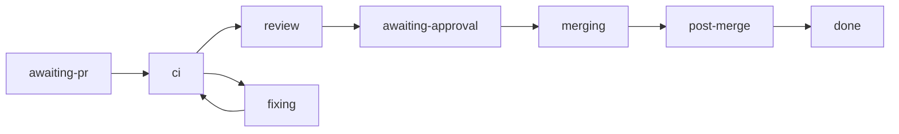

# Shepherd: from a registered PR to a merge

Shepherd is the `shepherd-pr` workflow inside the [factory](/guides/factory) and the
`titan-factory shepherd` verbs that drive it. You register a pull request, or a branch whose
pull request is not open yet. Shepherd then waits for CI, keeps the branch current, asks for
the merge decision its policy requires, merges the exact approved head, and reads main CI on
the merge commit.

Read [what is not built yet](#what-is-not-built-yet) before you rely on it. The review phase
runs only when `shepherd.review` is configured. Without it, every Shepherd merge waits for
the owner.

## Prerequisites

Everything in the [factory guide](/guides/factory#prerequisites): a built checkout, `gh`
logged in, and a base branch with at least one required check. Run `titan-factory serve` so
runs stay alive after your shell exits. Each verb below calls the server when one answers on
`--port` (default 7410) and opens the database directly when none does. Every verb takes
`--json` to print the result object instead of the one-line form.

## Register

```sh
titan-factory shepherd register owner/repo#123 --task initiative/42 --implementer impl-1
titan-factory shepherd register owner/repo --branch feat/example --task initiative/42 --implementer impl-1
titan-factory shepherd register owner/repo#123
```

```
run ab0f9228-… shepherd-pr owner/repo (feat/example): started; policy owner-gate
```

The target is `owner/repo#N`, or `owner/repo` with `--branch`. A missing `--task` or
`--implementer` is read from the head branch: `--branch` when given, else the pull request's
head. An `agent-chat/<name>` branch gives `<name>` as the implementer, and the first
`<letters>-<digits>` pair in it gives the task, upper-cased and qualified like a bare ID:
`agent-chat/dc-td-554-review-errors` registers implementer `dc-td-554-review-errors` and task
`<initiative>/TD-554`. An explicit flag always wins. A branch that yields neither is a usage
error (exit 2) naming the flag to pass and the branch it read. The other flags:

| Flag | Meaning |
| --- | --- |
| `--reviewer <name>` | the agent that reviews |
| `--kind <kind>` | `correctness`, `security`, `feature`, `refactor`, `test-only` or `unknown`; a new registration without it stores `correctness`. `test-only` is for a PR that only adds or changes tests; see [the test-only kind](#the-test-only-kind) |
| `--policy <json>` | narrows the seat policy; see [seat policy](#seat-policy) |

Registration is idempotent (`products/factory/src/shepherd/commands.ts`). A repeat for the
same `repo#pr`, or for the pull request's head branch, updates the task, implementer,
reviewer, kind and policy on the existing registration and returns the same run:

```
run ab0f9228-… shepherd-pr owner/repo (feat/example): already registered, metadata updated; policy never
```

A repeat starts a new run instead when the registration's run is dead: it failed, or it
completed stopped `not-mergeable` or on a `conflict` while the pull request is still open,
as when no agent took the conflict wake and a seat then pushed a fix. The new run starts at
the pull request's current head, the registration and its recorded authors move to it, and
the old run still reads. The verb prints `restarted after failed run <id>` or
`restarted after run <id> stopped not-mergeable`. A run that merged, or stopped for any other
reason (`abandoned`, `closed`, `stuck-behind`, `merge-denied`), comes back unchanged.

A repeat without `--kind` keeps the stored kind. What the kind controls today is carry and
these refusals: only `correctness`, `feature` and `refactor` may carry a reviewed MERGE across
a tree-equal update (MRG-AU-RC) or across a merge of the base whose remerge-diff resolved
nothing reviewed (MRG-AU-RM); `security` and `unknown` always get a fresh review. A tree-equal
update carries only when it is a clean merge-up: its first parent is the reviewed head (or a
head an earlier merge-up carried that MERGE to), its second parent is on the base branch, and
its tree equals `git merge-tree --write-tree` of the two. A conflict resolution, an extra
commit or a rebase gets a fresh review. The run log records each clean merge-up as an
`sh-merge-up` step naming the reviewed head, the new head, the base commit and the rule
`clean-merge-up`. The kind also opens the fix-proof gate described next: `correctness`,
`security` and `test-only` runs read it. An explicit `--kind` replaces the stored kind, unless it would move a
`correctness` or `test-only` run to `feature`, `refactor` or `unknown`, or a `security` run to
any other kind. That repeat is refused with exit 65 and a reason naming both kinds. Moving
`correctness` to `security`, or `feature`, `refactor` or `unknown` to any kind, still applies.
A move into `test-only` meets the diff check [below](#the-test-only-kind).

On a `correctness`, `security` or `test-only` run, or any `fix/` branch, Shepherd reads the
head's fix-proof result before the review. A vacuous or test-less proof ends the round as
`NO_REPRO`, unless its mutation check proves it (see [the test-only kind](#the-test-only-kind)). A proof that shows nothing about the head goes to the reviewer marked unverified.
That covers an `error` verdict (a skipped base included), an untrusted run, and a result that
could not be read although one was due. A read that fails is read once more at the same head
first. A MERGE on such a head keeps the policy's merge-on-green grant (owner decision 303), so
under an `auto` policy it merges on the usual conditions. The merge evidence record and the
evidence PR comment name the unverified standing and the read's reason.

A branch registered first and its pull request registered later share one run. A
registration by number reads the pull request from GitHub to learn its head branch, so it
needs `gh`. A `--branch` that is not the pull request's head is refused.

With no server running, the run is recorded and the verb says so on stderr:
`no titan-factory serve answered on port 7410, so the run was recorded here; titan-factory
serve drives it`.

### The test-only kind

A pull request that only adds or changes tests runs the same production code on both sides of
the fix-proof, so base against head can only read `vacuous`. It proves itself with a mutation
spec instead: a `<test>.mutations.json` beside the test, declaring changes to production code
and the tests each one must fail (see
[the fix-proof reference](../reference/fix-proof.md#test-only-diffs-and-mutation-specs)). When
the diff adds or changes a spec, the `fix-proof-mutants` CI job applies each mutation to the
merge base with the head's tests overlaid, and the judge adds a `mutants` field to the
`fix-proof/v1` line.

The gate lets the review proceed on a `vacuous` line only when its `mutants` verdict is
`killed`, every changed test file has a spec of its own added or changed in the same diff, and
every selected test ran and passed at head (`provedByMutants`). A killed spec proves only the
test file beside it, so one beside an unchanged test cannot vouch for a test the PR changed.
A changed test file with no spec (listed as `mutants.uncovered`), a surviving mutation, a test
that fails or does not run at head, a mutants error, or a line from a judge that never checked
coverage leaves the `vacuous` verdict standing, so the round ends as `NO_REPRO`, and the wake asks the implementer for kills
rather than for a test that fails at the merge base, fencing the test files that still need a
spec. The judge adds `mutants` only when it reads
the diff from git as test material alone, so a line from a diff with source in it never passes
this way. A pull request with no spec reads `NO_REPRO` as before.

A `feature`, `refactor` or `unknown` run may move into `test-only` freely, since that only adds
the gate; a `security` run may not leave `security`. A `correctness` run may move there only
when the pull request's diff changes nothing but tests, carried test files, `*.mutations.json` sidecars and
`.changeset/*.md`. Shepherd classifies the diff from GitHub under `.github/fix-proof.json` at the
default branch's merge base and at its tip. It reads the diff before it refreshes the
registration or replaces a dead run, so a refusal names the first source path and leaves the
stored kind and the run as they were. The guard also refuses when the diff cannot be read in
full: a file list at GitHub's cap, a harness path, a pull request based on another branch, or a
read error. A new registration with `--kind test-only` is not refused, because a branch may have
no diff yet. The gate reads the judge's line at every head, and the judge re-checks the diff
there, so the kind never loosens it. The kind keeps the run on the gate and out of MERGE carry.

A `correctness` registration, stated or defaulted, on a pull request that changes only tests
prints a hint after the run line:

```
hint: this PR changes only tests; re-register with --kind test-only and add a <test>.mutations.json sidecar, or fix-proof reads it as NO_REPRO
```

## Phases



A phase is a view over the run's current step (`products/factory/src/shepherd/view.ts`).

| Phase | The run is |
| --- | --- |
| `awaiting-pr` | polling every 30 seconds for a pull request on the registered branch, with no timeout |
| `ci` | reading branch rules, waiting for required checks, updating a branch that is behind, or rerunning a cancelled run |
| `fixing` | waking the implementer for red CI, a `FIX_FIRST`, a conflict or a failed fix-proof check, then waiting for its new head; or waiting for a new head after a human chose to await a fix |
| `review` | reading the review verdict and the registration's policy for a green head |
| `awaiting-approval` | recording the merge decision, waiting on a gate (`approve-merge`, `ci-failed`, `sh-sent-back` or `stuck-behind`), or holding an approved head whose base is [not the default branch](#feature-base) |
| `merging` | merging the approved head; a [held](#hold-and-release) pull request, or one waiting for the [merge train](#merge-train), waits here |
| `post-merge` | reading main CI on the merge commit, for up to 60 minutes, then [freezing on red or thawing on green](#after-the-merge) |
| `done`, `failed`, `cancelled` | finished |

A `done` run did not necessarily merge. A run that stops unmerged (closed, abandoned,
merge-denied, stuck-behind, not-mergeable, conflict) records an `sh-stopped` step with the
reason, and the `WatchRow` `outcome` field reads `merged` or `stopped` with that reason.

Shepherd runs no deploy, release or activation stage and does not run the factory's
`postMerge` chore.

### Review panel {#review-panel}

`shepherd.review.panel` in the factory config chooses how many reviewers a head gets. It
takes `off`, `shadow` or `on`, and an absent key means `off`.

| Value | What a head's review does |
| --- | --- |
| `off` | One reviewer, under `sh-review:<head>` and `sh-await-verdict:<head>`, as before the flag |
| `shadow` | The same single reviewer; `sh-review-intent` also records the head's `class`, `touches` and panel `plan` |
| `on` | The planned panel: every member reviews the head, and `sh-review-panel:<head>` records their aggregate verdict |

Under `on` the intent also records `panel: "on"` and `panelReviewers`, the name of each
member other than correctness: the correctness reviewer's name with the shape as a suffix
(`rv-octo-demo-12-adversary`). A standing reviewer serves many PRs, so its members take the
PR's fresh-reviewer base instead. Either way, round-end parking and cleanup find a member by
the PR's base, just as they find its fresh reviewers. The correctness member keeps today's steps, including its late
read, correction turn and usage-limit hold. Every other member gets `sh-review:<head>:<shape>`
and `sh-await-verdict:<head>:<shape>`, at its planned profile, with its shape's brief, and
checks out under `<review checkouts>/<shape>`. All members are started before any verdict is
awaited.

The aggregate decides:

- A `FIX_FIRST` from any blocking member sends the head back. The findings carry each
  member's text under its shape, and end with the panel's `Defect class:` line, which the
  fixer's structural brief reads.
- A MERGE needs a MERGE at the head from every blocking member. It carries
  `panel: {satisfiesG10, degraded, members}`, naming each member that gave a verdict.
- A blocking member that gave no verdict ends the review with no verdict, never a MERGE.
- An advisory member's finding is kept only when the files it cites read at the head.

The plan is read from the recorded intent, so a run whose intent was recorded with no plan
(before the flag, or under `off` or `shadow`) finishes as a single reviewer even after a
restart onto `on`.

## After the merge {#after-the-merge}

The `sh-main-ci` step reads main CI on the merge commit once, for up to 60 minutes. What
happens next depends on the verdict (`products/factory/src/shepherd/post-merge.ts` and
`main-red.ts`).

A run at the merge commit that concurrency cancelled because a newer main push superseded
it is not red. When every failed run was cancelled and main's tip is a later push that
contains the merge commit, Shepherd reads CI at that tip instead (`MAIN_CI_ROUTES` in
`products/factory/src/shepherd/route-table.ts`). A cancelled run with no newer push is red.

Which runs judge the commit depends on the base branch's rules. When it requires status
checks (rulesets first, then classic branch protection), only those required contexts judge
it, each by its newest run from the app it is pinned to (GitHub Actions when unpinned). A red
job outside them, such as `release` or `deploy`, is recorded as a `warning` on the step's
result and freezes nothing. A required context with no run yet, or one still running, is not
green. A repo with no required checks, or a rules read that fails, keeps the rule that every
Actions run on the commit must pass, so an API failure never thaws a red main.

**Closing the task.** Whatever the verdict, the last step, `sh-cleanup`, closes the registration's
`--task` over active-work's loopback rpc when the registration names no `--slice`. It first appends
`closed by Shepherd: <owner/repo>#<n> at <merge sha> merged` to the task's notes, then marks it done.
A task that is already done is left alone, so a replay after a restart closes nothing twice and adds no
second note. If active-work cannot be reached, the step gives up after an hour, records `task <initiative>/<id> not
closed: <error class>` as a caveat on its result, and the run still completes. A slice registration only
notes the landing and leaves its task open for the seat to close after live evidence.

**Unread.** No run appeared at the merge sha. The run opens `main-red` and freezes nothing.

**Red.** The run freezes the repo, then works through three steps:

1. `sh-freeze` freezes the repo at the merge sha. A freeze is one row per repo; a red in a
   live freeze counts up, and a red after a thaw starts a new episode.
2. `sh-file-fix-task` files one high-severity active-work task per episode, over
   active-work's loopback rpc (`127.0.0.1:$AW_PORT`, default 7400). The task goes into the
   initiative of the merged pull request's `--task` when that reads `<initiative>/<id>`, and
   into `titan-platform` otherwise. It carries the failing jobs and their fenced log tails,
   and is tagged with a key built from the repo and the merge sha, so a replay after a crash
   finds it instead of filing a second one. A daemon that is down is retried for up to 60
   minutes.
3. `sh-spawn-fixer` spawns one fixer per episode, if the run's policy grants `fixer`. The
   grant holds when a seat lists the repo and `--policy` does not set `"fixer":false`. The
   fixer is a headless agent-chat agent on the `bd-implementer` profile (a pane nobody
   watches would help no one, and that profile's grant covers the verbs it needs), named
   `fix-<repo>-<short merge sha>`, started in the repo's seat checkout. Its brief tells it to
   register its fix pull request with the fix task and with itself as `--implementer`. It
   needs `shepherd.agentChatBin` in the [config file](/guides/factory#the-config-file).

Both steps write only to the episode `sh-freeze` returned. If the repo thaws while a step
waits, the step files or spawns nothing more, records nothing, and the run moves on to
cleanup without a gate. That holds even if a new red has frozen the repo again. A fixer
already spawned by then is reported in the step's detail and keeps running.

While the repo is frozen, every merge route waits in `merging`, the same way a hold does.
One pull request is exempt: the one whose registration names the episode's fix task and
the episode's fixer as its implementer. The guard also re-reads the default branch at most
every five minutes, and a green head there thaws the repo.

**Green.** `sh-unfreeze` thaws a frozen repo when the merge commit descends from the red sha
and every check that was red there ran green again (when the base branch has required
checks, every required context green). A path filter that skips a red check
therefore cannot thaw it.

Every outcome that leaves the repo frozen with nothing in place to clear it opens a gate
with the owner's release on offer:

- `main-red-again`: main went red while the episode already had a fixer, the fixer's own
  merge included. No second fixer is spawned.
- `main-frozen`: no fix task was filed, no fixer was spawned (notify-only policy, no
  agent-chat, no checkout, or a failed spawn), or a green merge left the repo frozen.

The answer is `{"decision":"stay-frozen"|"unfreeze","mergeSha":"<merge sha>"}`. `unfreeze`
thaws only the episode the gate opened for. If the repo has thawed and frozen again since,
the answer changes nothing. Each run opens its own gate, so one episode can leave several
open; answer any one with `unfreeze` and the rest go stale.

## Routing a reviewed head {#routing}

After the review of a green head, the `sh-observe` step reads the pull request again, and one
table decides what happens next (`products/factory/src/shepherd/route-table.ts`). The table
is keyed by three things: whether the pull request is still open, GitHub's
`mergeable_state`, and what the review came to. Every cell has a route, and a test fails if
one is missing.

| State at `sh-observe` | `MERGE` | `FIX_FIRST` | no verdict, or the wait ran out | hold's reviewer has not answered |
| --- | --- | --- | --- | --- |
| `clean`, `blocked`, `unstable`, `has_hooks` | merge decision | wake the fixer | fresh reviewer | read the hold's reviewer again |
| `behind` | update the branch, new round | wake the fixer | update the branch, new round | update the branch, new round |
| `dirty` | wake the fixer | wake the fixer | wake the fixer | wake the fixer |
| `unknown` | new round | wake the fixer | new round | new round |
| `draft` | end the run | wake the fixer | end the run | end the run |

A head that moved during the review always starts a new round, and the new head is reviewed.
A pull request merged or closed outside Shepherd ends the run: a merge goes on to the
post-merge read, a close stops. `titan-factory serve` also checks, every 5 minutes, the pull
request of each run that is waiting on a gate. When that pull request was merged or closed
elsewhere, the serve process cancels the run and its gate, whichever gate it waits on and
whether the run is held. A run waiting on a main-red, main-red-again, main-frozen or
after-stages gate is left alone: those gates are about main and, for a freeze, hold the owner's
release, so only an owner or a coordinator on a green main clears them. A coordinator may also abandon a gate
whose pull request is merged or closed (and only abandon, only on a fresh read of that state).
The same check supersedes a gate
whose open pull request moved head, as resync does below.

Every `titan-factory serve` start resyncs before it adopts a run. Each running or paused run
whose pull request was merged outside Shepherd ends with a reason that starts
`landed elsewhere: `, and one whose pull request was closed ends with `closed elsewhere: `. A
pending gate whose run already ended is cancelled as orphaned, and a gate whose open pull
request moved head is superseded. That covers a seat-policy, merge-guard, MRG-AU or
`shepherd-route` (`failed-rounds`, `fix-first-runaway`, `no-progress` or `conflict`)
`approve-merge` gate, an `sh-sent-back` gate, a `ci-failed` gate and a `stuck-behind` gate. A
superseded `shepherd-route` gate is only cancelled, never answered: the run reviews the new head and
asks the owner again there, with the gate naming the carried reason and the new review (TP-3083). A
superseded failed-rounds gate also starts the new head's review rounds from zero, and a fresh
`MERGE` at the new head does not clear it. For a fix-first-runaway, no-progress or conflict gate the one
exception (owner decision 303) is a head where the dispatched reviewer wrote a fresh `MERGE` at
exactly that head and an `auto` policy allows it under MRG-AU-RV: the run merges with no gate and
records the rule `shepherd-route/<escalation>/cleared-by-merge` naming both heads. A `MERGE`
carried by tree, remerge or merge-up does not clear it. The carried reason stays on the run across
send-backs, fixer pushes and further head moves until the owner answers an `approve-merge` gate. A superseded `ci-failed` gate reads as
`await-fix`, so the run lands the new head with no owner answer. A superseded `stuck-behind`
gate starts a new land round at the new head with a fresh update budget. Resync also answers
the active `merge` step of a run no runtime holds, when the head that step merges is no longer
the pull request's head: the answer is no merge, so the run reads CI and reviews the new head. A run that recorded its own `merge`, `sh-landed` or a
post-merge step is Shepherd's merge and is never ended this way. The run is read again after
its pull request is read, so a merge it records during that read keeps it too. A pull request that cannot be read leaves
its run alone. Resync, and the 5-minute check, also mark a merged run reverted: for each repo
with a run that merged in the last 7 days, one paged read of main since the earliest such merge
looks for a commit whose body says `This reverts commit <merge sha>` or whose title is
`Revert "<merge commit subject>"`, with or without its own ` (#n)`. The run gets an
`sh-reverted` step that records the merge sha and the reverting sha, and is never marked twice.
`titan-factory shepherd resync` runs the same pass by hand, and `--dry-run`
prints what it would end, cancel or supersede and writes nothing.

Resync also supersedes an MRG-AU `approve-merge` gate whose cause may since have passed. Some
MRG-AU allow row must have had only transient conditions unmet, `merge-tree-clean`,
`repo-not-frozen` or both, and the gate must still be at the pull request's head. The cancel
reason starts `superseded: review again: ` and names the conditions, and the run asks the
policy again at the same head. A head a reviewer already said `MERGE` at keeps it: the run records
`sh-review-refused` with reason `merge-standing`, reads the merge evidence again, and
dispatches no reviewer. A `MERGE` carried to the head goes back through the carry's checks
instead, so a seat's `FIX_FIRST` posted since still stops it. A row with any other unmet condition, such as
`verdict-merge-at-head`, leaves the gate with the owner, and so does a repo the freeze store
still holds frozen. When a freeze thaws, whichever path thawed it, `titan-factory serve` runs
the same sweep at once for that repo's gates. If a pull request's head cannot be read during
that sweep, the repo stays queued and the next sweep tick tries it again. A thaw listener that
throws is logged and does not stop the others.

One gap is left to resync. A run that read `repo-not-frozen` as unmet, then saw the repo thaw
before its gate opened, opens a gate the thaw sweep has already passed. That gate waits for the
next `titan-factory shepherd resync` or server start. Shepherd does not sweep every
transient-only gate on each tick, because a `merge-tree-clean` gate would then be superseded
again on every tick while the merge tree stays dirty.

A reviewer that misses the 30-minute wait is read again before Shepherd gives up on it. The
`sh-late-verdict` step reads that reviewer's final message until it holds a verdict at the
head, the reviewer has exited, or 10 minutes pass. A reviewer held up by a permission prompt
that writes `Verdict: MERGE` after the deadline is therefore read as MERGE, and its merge
goes through the evidence step like any other.

A fresh reviewer is spawned under a name nobody has held, and a standing reviewer is not
resumed. A run held with `hold --reviewer <name>` starts no reviewer of its own. It takes the
newest verdict that reviewer gave at the head, so a `FIX_FIRST` from it wakes the
implementer. Shepherd never reads a reviewer's name out of the hold's reason text. A
`g10-adversary:` hold is the exception: it needs two independent `MERGE`s, so Shepherd
still spawns its own reviewer, and the named reviewer's verdict only satisfies the hold
(`adoptedReviewer` in `products/factory/src/shepherd/external-review.ts`). A seat can also
ask for Shepherd's own review with [`shepherd review`](#own-review).

`approve-merge` opens for five reasons only, and its prompt names the reason:

- `shepherd-route/conflict`: a merge conflict survived one fixer attempt. Answer `merge` to
  have Shepherd land the next resolved head, or `abandon`.
- `shepherd-route/failed-rounds`: 3 review rounds failed at this task. Only a stuck round
  counts: a fresh reviewer after silence or a timeout, a re-read of a hold's reviewer, or a
  conflict. A `FIX_FIRST` that yields a new head is progress and does not count.
- `shepherd-route/fix-first-runaway`: 3 `FIX_FIRST` reviews at this task, for every kind of PR.
  Two fix rounds that did not converge mean point fixes are not working, so Shepherd wakes no
  third fixer. Route the task to the planner to redesign or split it; Shepherd files no planner
  task itself. It is checked before `no-progress`, so a third `FIX_FIRST` always names this
  route.
- `shepherd-route/no-progress`: 2 `FIX_FIRST` reviews in a row ended with `Closer: no`, meaning
  the head is no closer to `MERGE` than the last one. A `FIX_FIRST` with `Closer: yes` or no
  Closer line, and any other round, resets the count. Under the cap of 3 it can only fire at
  the second `FIX_FIRST`.
- a policy that did not allow an automated merge, such as an `owner-gate` seat or an unmet
  `MRG-AU-RV` fact. The prompt starts `the authority policy did not allow an automated merge`.

Each `FIX_FIRST` wake records one `sh-wake-fix-first` step, so the run counts them across
every head it sees. After the first, every review is a re-review: its brief requires a
section that starts `Defect class:`, which names the defect class that recurs across the
rounds and the one boundary where a single fix covers every instance. From the second
`FIX_FIRST` on, the fixer gets a structural brief instead of another patch round. The brief
carries the reviewer's defect-class section and the findings as the verdict step stored
them. A re-reviewer that leaves the section out still gives a valid verdict. The fixer is
then asked to name the class itself before fixing.

The verdict step keeps at most `MAX_FIX_FIRST_TEXT_CHARS` (16,000) characters of a
`FIX_FIRST` message (`products/factory/src/shepherd/await-verdict.ts`). The cap covers every
path a `FIX_FIRST` arrives by: the reviewer Shepherd dispatched, the reviewer a
`hold --reviewer` names, and a seat reviewer. A seat reviewer's message counts its
`Seat reviewer <name> said FIX_FIRST at this head.` prefix toward the cap. A longer message
keeps its start, since the findings come first, and ends in a `[truncated]` marker. A
blocking item past the cap does not reach the fixer. Every review wake also appends the pull
request's unresolved review comments from owners, members and collaborators, at most 1,000
characters each and 6,000 in all.

A woken implementer must start a turn within 5 minutes: a new event in its transcript, or a
new head. A live implementer is messaged through `agent-chat debug send`, which delivers the
message as if the human sent it until agent-chat adds a `shepherd` wake source (CC-436). An ended one
is resumed or replaced by a successor. If no turn starts, one fallback goes out: a resume if
the agent has ended by then, else a second message. If there is still no turn, the wake is
unhandled.

A retired implementer is never resumed; a successor takes the wake. When agent-chat refuses to
resume an ended implementer, the same wake spawns a successor, under the spawn load gate. When
it refuses the successor as well, a review's send-back holds: `sh-wake-implementer` records the
refusal as `held`. Like a fixer that exits with no push, the repo's seat is told why no fixer
started and the run waits for a new head; if no notice is sent, `sh-sent-back` opens and names
the refusal. The watch row's next action and the timeline's wake entry carry the refusal, and the
row says the seat was told only when a notice was sent after that wake. A ci-red or conflict wake
records no `held`. A ci-red wake no fixer took goes to the seat as described in
[seat work](#seat-gates), and a conflict wake still stops the run as `not-mergeable`. Each such
wake still spends one repair from the `repair-budget`.

GitHub refuses `update-branch` with HTTP 422 `merge conflict between base and head` when the base
cannot merge into the head. That is not a failure: the land round stops with reason `conflict` and
takes the same route as a `dirty` PR. The first time, the implementer is woken with the conflict;
if the conflict is still there on the next `update-branch`, `approve-merge` opens with
`shepherd-route/conflict`. Any other `update-branch` error still fails the step.

### Seat work goes to the seat {#seat-gates}

Only owner approvals open an owner gate: `approve-merge` under an `owner-gate` or visual
policy, one-way items, and holds that need the owner. Three gates are seat work. Before
opening one, Shepherd records an `sh-seat-notice` step that messages the repo's seat, then
takes the gate's default action:

| Gate | When | Default action once the seat is told |
| --- | --- | --- |
| `ci-failed` | a red head no fixer took (a transient red still reruns first) | wait for a new head: the seat starts a fix round or a successor |
| `sh-sent-back` | a `FIX_FIRST` or `NO_REPRO` no agent took, a spent repair budget, or a fixer exit (the exit notice above) | wait for a new head |
| `stuck-behind` | the update budget and its retries are spent | answer `retry`: `update-branch` runs again with a fresh budget |

The gate opens only when no notice was sent: no single seat owns the repo, no notice is wired,
or the send failed. Its prompt then names why. A run tells the seat once per gate and head, and
a restart replays the recorded notice instead of sending it again. A run that was already
paused on one of these gates before the notice step existed keeps that gate.

A review round's Ship pick at one head (decision 97) is the owner's merge approval at that
head. Today it answers an `approve-merge` gate only after the gate is open, through
`roundMergeDecisions` (`products/factory/src/shepherd/round-merge.ts`). Nothing reads a Ship
record before the gate opens yet.

When a run reads a new head, it cancels its own pending `approve-merge` and `sh-sent-back` gates
whose prompt names an older head. A gate at the current head stays pending.

### An owner's merge answer follows a clean head move {#carried-answer}

An owner's `merge` answer at a head follows to a later land gate at the run's next head, so the
owner is not asked twice, in one case and no other:

- **Merge-up.** The new head is the approved head merged with a commit of the base branch, and
  its tree equals `git merge-tree --write-tree` of the two (or the merge resolved only declared
  generated files). A hand-resolved conflict asks again.

A fixer commit pushed after the approval never follows (TP-3070): the whole range from the approved head
to the new head is judged by tree equality with `git merge-tree --write-tree` of the approved head and
the base (`products/factory/src/shepherd/fix-carry.ts`), not by the shape of the last commit. A tree that
differs by one line asks the owner again; a base that is unknown or a merge-tree that cannot be computed
asks again too.

The merge-up needs a standing reviewer verdict `MERGE` at exactly the new head, and land opens the gate
only after required CI is green at that head, so a head with no verdict or a red check asks the
owner again. An `unknown` run never carries, and neither does an escalation gate. A `security` run follows
only the rule below.
Any error computing the tree or the diff asks again. The run records an
`sh-approval-carry:<head>` step with the approved head, the new head, the rule (`remerge-empty`,
`remerge-generated-only` or `merge-up`) and the proof: both trees and the paths. The probe itself is the `sh-approval-carry:fix:<head>` step.

A `security` run's answer follows one head move only: Shepherd's own clean merge-up
(`products/factory/src/shepherd/own-merge-up.ts`, step `sh-approval-carry:own:<head>`). The new head
must have exactly two parents, the first the approved head and the second on the base branch, its
tree must equal `git merge-tree` of the two, and none of the files the base side changed since the
pull request left it may be a file the pull request changed (a rename counts as both sides). A
non-merge commit, another first parent, a second parent off the base, a hand-resolved or amended
tree, or one overlapping file asks the owner again. The `sh-approval-carry:<head>` step records the
rule `own-merge-up`, both trees, the base commit, and the pull request's and the base side's paths.

## Watch

```sh
titan-factory shepherd status                  # every registration
titan-factory shepherd status owner/repo       # one repo
titan-factory shepherd status owner/repo#123   # one pull request
titan-factory shepherd status --active --branch-prefix pc-   # live runs on agent-chat/pc-* branches
titan-factory shepherd status --phase review,merging --task TP-42
titan-factory shepherd waiting                 # pending gates, oldest first
titan-factory shepherd prs owner/repo --json   # open PRs from the snapshot, plus Shepherd's merges
titan-factory shepherd list --state all        # active (default), finished or all
titan-factory shepherd timeline owner/repo#123
titan-factory shepherd timeline owner/repo#123 --last 8 --width 300
titan-factory shepherd wait owner/repo#123 --until merging,done --timeout 900
```

```
owner/repo#123 ci 1a2b3c4 waiting for CI on 1a2b3c4
owner/repo feat/example awaiting-pr - waiting for a PR on the registered branch
```

`status` takes four filters, which combine with each other and with a target and narrow the
text, `--json` and `--json --deploy` rows alike. `--active` drops runs that are `done`, `failed`
or `cancelled`. `--phase a,b` keeps those phases; an unknown phase exits 2 and names the valid
ones. `--branch-prefix p` matches the branch with or without its `agent-chat/` prefix. `--task id`
takes a bare ID, matched in any initiative, or `slug/ID`, both case-insensitive. The CLI filters
the rows it gets back, so the flags work against an older `serve`. Without them the output is
unchanged.

Each line is the target, the phase, the short head, the next action, and any blockers in
brackets: `held: <reason>` or `stalled: <reason>`. A row reads as stalled for one of three
causes, checked in this order (`products/factory/src/shepherd/view.ts`):

1. The run is `failed` or `recovery_required`. The reason is the run's error, or its status
   when it recorded none.
2. `MAX_NOT_STARTED_REVIEWS` (3) review dispatches in a row started no reviewer, because the
   broker kept refusing. The reason reads `3 review dispatches in a row started no reviewer`.
3. The run has sat in one phase past its `PHASE_STALL_LIMIT_MS` limit. The reason reads, for
   example, `75 min in ci, over the 60 min limit`.

| Phase | Stall limit |
| --- | --- |
| `ci` | 60 minutes |
| `fixing` | 240 minutes |
| `review` | 120 minutes |
| `merging` | 15 minutes |

The clock starts when the run entered the phase. The other phases wait on a person or an
agent by design and have no limit. With nothing registered the verbs print
`no shepherded PRs`. `timeline` prints the same row and then every step, CI read and gate
the run recorded, oldest first. `--json` returns the `WatchRow` and `PrTimeline` shapes the
factory UI reads. `--last N` keeps only the last N entries and prints `… <k> earlier entries`
under the row line when it cut any; with `--json` it slices `entries` the same way.
`--width W` cuts every text line to W characters, ending a cut line in `…`. Both replace
piping `timeline` through `tail` and `cut -c`.

`shepherd wait <ref> --until <phase[,phase]>` polls the PR's status row, through serve when one
answers, else the database here, every `--interval` seconds (default 15). It exits 0 once the
row's phase is one of `--until`. It exits 1, with the reason on stderr, when the run ends in
`done`, `failed` or `cancelled` and that phase is not in `--until`, or when `--timeout` seconds
(default 900) pass; the timeout message names the last phase seen. An unknown phase in
`--until` exits 2 before any poll.

`shepherd waiting [--json]` lists every pending gate, oldest first, with its gate ID, repo and
PR, head, task, age in hours and held reason. It builds on the same rows as `status` and writes
nothing. Gates the owner answers (`approve-merge`, `release`, `one-way`, `failed-rounds`, main-red
and any kind not listed as seat work) come first; seat work (`ci-failed`, `sh-sent-back`, `stuck-behind`)
is listed apart, because those are routed to the seat that owns the PR. `--json` prints
`{ owner, seat }`, each an array of gates. Each gate carries `headIsCurrent`: true when the head
the gate names is the run's current head, false when the run has moved on, null when the gate names
none. The verb exits 1 when an owner gate is older than 24 hours, and its text says how many are.
The factory digest lists the five oldest owner gates under "Waiting on you".

`shepherd prs [owner/repo] [--json]` lists the open PRs of every seat repo, or of the repo
named, from Shepherd's PR snapshot (`products/factory/src/shepherd/prs.ts`). A seat repo with no
run in it is listed too. The answer makes no GitHub call while the repo's open list is under a
minute old, and concurrent callers share one list read. The PRs Shepherd itself merged in the last
24 hours follow, built from each run's `merge` step, so their `mergeSha` costs no PR read. Each
row is `{ repo, number, branch, headSha, base, state, mergedAt, mergeSha, title, body, draft,
registered, runId?, phase?, ci?, source, at }`. `state` is `open` or `merged`. `source` is
`snapshot` or `merge-step`, and `at` is when that source was read. `ci` is
`{ head, state, requiredMissing, at }`, where `state` is `pending`, `green`, `red` or `none`. It
appears only when the snapshot already holds the head's check runs. A head it holds none for
leaves `ci` out rather than reading GitHub. `requiredMissing` names the run's required contexts
that have no check run on the head. A serve wired without a snapshot refuses with exit 69.

## Stats {#stats}

```
titan-factory shepherd stats [--from YYYY-MM-DD] [--to YYYY-MM-DD] [--json]
```

Reads the store read-only, so it is safe beside a running `serve`. Two reports, both in UTC:

- Per repo and ISO week: merges, those whose wait between the reviewer's `MERGE` and the merge
  itself exceeded 60 minutes (with their total hours), and merges made outside Shepherd. The
  same row carries the [merge-up](#merge-up) counts:
  - `slowOwnerGated`: the slow merges whose wait held an owner `approve-merge` gate inside the
    window from `MERGE` to merged. The rest are slow for some other reason.
  - `mergeUps`: Shepherd's own update-branch steps, by the CI read before each one.
    `landTime` is a refresh after the merge decision, when the base had moved since the green.
    `strictChase` is an update before the decision, which only a strict repo forces.
    `freezeHold` is an update from a freeze hold after a thaw, `baseRed` is an update from a
    freeze hold after the red base it waited on moved, and `retry` is an update after
    `update-backoff`.
  - `strictRounds`: land rounds whose `land-rules` read found the repo requires up-to-date heads.
    Anything above 0 means the strict setting is back on.
  - `foreignMergeUps`: heads Shepherd did not make that are a merge of the base. It stays 0
    until Shepherd records the origin of foreign heads (`sh-head-origin`).

  The text line prints them as `slow owner-gated`, `merge-ups land/strict/freeze/base/retry`,
  `strict rounds` and `foreign merge-ups`.
- Per day, the owner's friction. **Owner touches** counts the gates an owner class resolved that
  day. For each gate kind (the gate's step id without its iteration, such as `approve-merge`,
  `ci-failed`, `sh-sent-back`, `stuck-behind`, `main-frozen`) it shows how many gates waited and
  the median and maximum hours they waited on the owner. A gate resolved by the owner waited from
  its opening to its resolve and counts on the resolve day. A gate still pending is waiting on the
  owner, so it counts to now, on today's row. A gate any other actor resolved is not the owner's
  and is left out. Releases do not appear: `shepherd release` records no actor.

- Per repo and ISO week, the time per stage: for each of `queued`, `ci`, `review`, `re-review`,
  `hold` and `land`, how many runs spent time in it and the median, p90 (nearest rank) and
  maximum minutes per run, summed over the run's visits. The ledger records only when a step
  completed, so a step's time is the gap since the step before it, and the stage is that step's
  phase (`ci` includes the fixer's wait for a new head; `hold` is the owner-decision gates). A
  review after the run went back through CI or a fixer is a `re-review`, which covers a head
  move and a clean merge-up. Time after the merge is in no stage. A hold polled inside the
  merge step leaves no trace in the ledger, so `stats` counts it under `land`; `status` does
  name a live hold.

- Per repo and ISO week, red after merge: the merged runs that read main CI at their merge,
  those whose stored `sh-main-ci` read was red, and the rate, plus those since marked
  `sh-reverted` (see resync above). A run that read main CI more than once counts its last read.

- With `--failures`, per repo and ISO week: failed runs counted by failure class (`ci-timeout`,
  `gh-api-5xx`, `land-rules`, `update-branch`, `other`). Shepherd writes the class as the
  error's `[<class>] ` prefix; an older error without one is classified from its text. A
  `gh-api-5xx` is GitHub's side giving out: a 5xx, no connection, or an empty body. JSON adds
  `"failures": [{ repo, week, failures, byClass }]`.

`shepherd status` adds `(<stage> <n>m, <n>m total)` to each live row: the stage the run is in,
the minutes it has been there, and the minutes since registration. `status --json` carries them
as `stage` and `totalMinutes`.

`--json` returns `{ "merges": [...], "ownerFriction": [...], "stageTimes": [...], "redAfterMerge": [...] }`;
each `merges` row carries `mergeUps` (`{ landTime, strictChase, freezeHold, baseRed, retry }`), `strictRounds`,
`slowOwnerGated` and `foreignMergeUps`;
each `redAfterMerge` row carries `merged`, `red`, `rate`, `redPrs`, `reverted` and `revertedPrs`. The morning digest shows today's
two lines, "Owner touches" and "Owner wait (median/max hours)", under "Owner friction".

### Review causes {#review-causes}

Each `sh-review-intent` step records why Shepherd dispatched a reviewer at that head, as
`cause` and, for some causes, `reason`. The run derives it from its own steps, with no extra
GitHub call:

| Cause | When |
|---|---|
| `first` | The run's first review. |
| `fix-round` | A new head after a `FIX_FIRST` or `NO_REPRO` send-back. |
| `conflict`, `ci-fix` | A new head after a conflict or red-CI wake. |
| `superseded` | The head moved while the last review ran. |
| `update-branch` | Shepherd's own update-branch moved the head, and there was no `MERGE` to carry. |
| `merge-up-not-carried` | Shepherd's update-branch moved a head with a `MERGE`, and the carry refused. `reason` is `not-one-merge`, `base-off-branch`, `remerge-touched`, `seat`, `base-unknown` or `probe-failed`. |
| `kind-no-carry` | The `MERGE` could not carry because of the registration's kind. `reason` is that kind, or `unregistered`. |
| `seat-push` | A push Shepherd did not make moved the head; after a `MERGE`, `reason` says why it did not carry. |
| `retry` | The same head again after no verdict. `reason` is `timeout`, `no-verdict`, `depth-floor`, `malformed`, `not-started` or `machine-stop`. |
| `hold` | The hold's reviewer is read again. |
| `owner-request` | A resync asked for the review again. |
| `seat-request` | A seat's `shepherd review` asked for Shepherd's own review at a head the run already had a verdict at. |
| `unknown` | Recorded before causes existed, or nothing explains it. |

`stats` adds a "review causes" section: per repo and ISO week, every review dispatch counted
by cause, labelled `cause(reason)` when there is a reason. `--json` adds `reviewCauses`, and
`--rereviews` prints only this section, as text or with `--json` as `{ "reviewCauses": [...] }`.

### Review cost {#review-cost}

```
titan-factory shepherd stats --cost [--from YYYY-MM-DD] [--to YYYY-MM-DD] [--json]
```

`--cost` prints this report instead of the sections above. For each merged PR it takes every review
round across all the PR's runs: a round opens at its `sh-review` dispatch (or an external review
intent) and ends at the last step that resolved it, the on-time `sh-await-verdict`, its
`:corrected` reply, or `sh-late-verdict`, whether that step held a verdict or a timeout. It reads
the reviewer transcript the round's verdict locator names, or for a round with no verdict the one
another verdict named for the same session, and prices each request with session-analytics
`priceRequest`. It reports list-price dollars and tokens (input, cache read, cache write, output)
per PR, then per repo and ISO week of the merge, then in total, with the p50 and p90 dollars per
merged PR. A round counts only the requests from its review intent to the step that resolved it,
so a standing or `hold --reviewer` session that serves several PRs is split between them, and
requests after that step count nowhere. A request counts once in the whole report, even when a
resumed session repeats it. A round that cannot be priced (a missing transcript, a model with no
price row, a parse error, an external review or a timed-out round with no transcript, a round no
step resolved, or one with no requests in its window) is listed under `unreadable` with its reason
and adds nothing to the dollars. A PR with one is left out of p50 and p90, so they never treat a
gap as zero. `--json` returns `{ "reviewCost": { prs, weeks, totals } }`.

### SLOs {#slo}

```
titan-factory shepherd stats --slo [--registry FILE] [--from YYYY-MM-DD] [--to YYYY-MM-DD] [--json]
```

`--slo` prints this report instead of the sections above. It reads the `titan.metrics/v1` entry
`metrics/shepherd.yml` from the factory's own checkout, or `--registry`, and evaluates every metric
in file order. A metric whose query has `kind: cli`, `store: shepherd-stats` and a query id in
`text` (such as `flow.merge-verdict-to-merged-p90`) is measured over its SLO's window, whole UTC
days ending today (`1d`, `7d` or `28d`; seven days for a metric with no SLO), or over `--from` and
`--to` for every metric. Each line gives the status, the value and unit, the SLO, the window and
`n`, the count the value rests on. The statuses are `pass`, `fail`, `no-data` (nothing in the
window to measure, never reported as a zero), `no-slo`, `no-query` (the metric names the slice
that would add a query, its `gapSlice`) and `error` (a query id stats does not know, a query for
another store, or a query that threw, such as unreadable transcripts). It exits 0 whatever the
statuses; a missing or invalid registry exits 2. `--json` returns `{ "slo": [...] }`.

## Seat policy {#seat-policy}

Every registration resolves a policy before anything starts
(`products/factory/src/shepherd/policy.ts`). The merge mode is one of three:

| Mode | Effect |
| --- | --- |
| `never` | the merge decision is `deny` and the run stops |
| `owner-gate` | every merge waits on the `approve-merge` gate |
| `auto` | a merge may go through without the owner when the authority row holds; otherwise it gates |

The ceiling comes from seat files. A repo that no seat lists gets `owner-gate`. A seat whose
`grants_extra` includes `merge-on-green-approve` raises the ceiling to `auto`. A seat that
lists `visual_paths` also gets `auto`, but only for pull requests that change no visual file
(see [Visual paths](#visual-paths)). A seat whose `grants_extra` includes
`merge-into-feature-base` lets its runs merge into a base other than the default branch (see
[Feature base](#feature-base)). A Version Packages pull request merges on its passed
preflight only when the seat's `grants_extra` also includes `release-merge`, because that
merge publishes to npm. Under `auto` without it, the release gates as
`shepherd-release/no-release-grant`. `--policy`
can only narrow the ceiling, never widen it: `{"merge":"auto"}` on an unlisted repo still
resolves to `owner-gate`. The other `--policy` keys are `mergeMethod` (`merge`, `squash` or
`rebase`; default `squash`), `reviewer`, `priority`, `fixer` and `ownerGateReason`. An unknown
key is refused.

A request with `"merge":"owner-gate"` must also name why the owner is asked, with
`ownerGateReason` set to `gate-2-visual`, `g10-security`, `proof-fixture` or `owner-asked`.
Without it the registration is refused and the CLI exits 65 with a message naming the four
reasons; the reason with any other merge mode is refused too. The reason is stored in the
effective policy, a repeat registration keeps the first one, and the gate reason shows it:
`policy owner-gate (gate-2-visual) waits for the owner`. A run registered owner-gate before
this field, with no reason, keeps working and reads as legacy. The owner digest lists a
`proof-fixture` run in its own "Proof fixtures" section, with its gates and age, and leaves it
out of the asks, merged and stuck lists; `shepherd status` shows it as usual.

Seat files are read from `shepherd.seatsDir` in the
[config file](/guides/factory#the-config-file): every `*.md` file there, frontmatter only
(`products/factory/src/shepherd/seats.ts`).

```markdown
---
schema: autonomy-seat/v1
name: platform
repos:
  - path: ~/projects/example-repo
    remote: owner/example-repo
deny_repos:
  - ~/projects/dotfiles
grants_extra:
  - merge-on-green-approve
visual_paths:
  - packages/ui/src/components/**
  - "**/*.stories.tsx"
---
```

- **`repos`** lists the remotes the seat owns. A remote that several seats list gets only
  the grants they all share.
- **`visual_paths`** lists repo-relative globs (`**`, `*`, `?`, `{a,b}`, matched without case) for files the owner
  reviews by eye. An empty list or a glob that cannot compile makes the seat file invalid, as
  does a glob no repo-relative path can match: leading or trailing whitespace, a backslash, an
  empty segment (a leading, doubled or trailing `/`), or a `.` or `..` segment, in the glob or
  in any of its `{a,b}` alternatives, or a fullwidth slash or invisible format character.
- **`deny_repos`** lists checkout paths no registration may target. A deny path that a seat
  binds to a remote denies that remote. A path no seat binds denies its last segment as a
  repo name under any owner.
- **Charter hard stops.** `shepherd.charterPath` names an `autonomy-charter/v1` file with a
  `hard_stops` list. `shepherd.hardStopRepos` maps a hard-stop id to the remotes it forbids.
- A deny wins over any seat. The refusal is
  `registration refused: owner/repo is on a seat deny list or a charter hard stop`, and no
  run starts.

### Visual paths {#visual-paths}

A seat with `visual_paths` resolves to `auto` even without `merge-on-green-approve`. At each
head Shepherd decides, it matches the changed files the merge evidence read at that head
(both sides of a rename) against the globs. Files that cannot render never match: names
with `.test.` or `.spec.`, and names ending `.md` or `.d.ts`.

- no file matches: the merge goes on to `MRG-AU-RV`, which still needs a `MERGE` at the head
  and green required checks;
- a file matches: the merge gates on `visual-path`, and the reason lists the files;
- the file list failed to read, was truncated or came back empty: the merge gates on
  `files-unread`, and the reason says the pull request counts as visual.

A push after registration is judged at its own head, so a later commit that adds a visual
file gates. A remote that several seats list gets the union of their `visual_paths`, so a
file any of them calls visual gates. If one of those seats has neither `visual_paths` nor
the merge grant, the remote stays at `owner-gate`. A seat with both the grant and
`visual_paths` still gates visual files. `--policy '{"merge":"owner-gate","ownerGateReason":"gate-2-visual"}'` still gates
every merge. A seat without `visual_paths` behaves as before.

The seat book is read again on every `register`, so a change applies without a restart. An
invalid seat file or charter fails every registration until it is fixed. Path spelling
rules are in the
[product README](https://github.com/HJewkes/titan-platform/blob/main/products/factory/README.md#shepherd-seat-paths).

The run re-reads its registration's policy before every merge decision and keeps the
stricter of the two. A later `register` can tighten a running pull request's policy. It
cannot loosen it.

### Feature base {#feature-base}

A pull request merges only into its repo's default branch unless its seat says otherwise. Stacked pull requests are the reason: a child's GitHub base is its parent's
branch, and GitHub's merge lands in whatever base the pull request names when it merges.

Before every merge the land core records a `base-check` step. It reads the pull request and
the repo's default branch live from GitHub, never from the snapshot. When the base is not the
default branch and the policy does not allow a feature base, the approved head waits in a
`base-wait` step. A run that holds its repo's [merge train](#merge-train) gives it up before it
waits, so other pull requests keep merging. `shepherd status` names the base as the next action:

```text
waiting for a retarget: the base is feat/x, not the default branch main, and the run's policy merges only into main
```

The wait has no timeout and neither fails nor cancels the run. It ends when the pull request
is retargeted, gets a new head, or is merged or closed elsewhere. The run then reads CI again.
A green read that names a new base reads the branch rules again for that base, and the next
`base-check` decides. Every land round also reads the rules and the base afresh. GitHub's merge
reads the base once more before it writes, and again before each retry. A pull request
retargeted after its `base-check` is skipped as `base-changed`, so a refused base never
reaches GitHub's merge.

An approval covers one head on one base. The `approve-merge` prompt names the base
(`Merge PR #12 in owner/repo at head <sha> into main?`). When `base-check` finds a base other
than the one the head was approved or allowed on, the run drops that trust, re-reads the merge
evidence (changed files and visual paths) against the new base, and decides again. An owner
gate asks again, and an approval never follows to a later head on another base.

A stacked pull request waits at `base-wait` with no gate: the `base-check` runs before the
merge decision too, so no `approve-merge` gate opens and no merge policy is decided while the
base is refused. Once GitHub retargets it to the default branch, the run decides on that base,
and a reviewer's MERGE with green required contexts merges under MRG-AU-RV. A decision whose
merge evidence was read on a base other than the one just checked gates instead of allowing.
The head-moved sweep also cancels, as superseded (condition `base-changed`), any pending
`approve-merge` gate whose prompt names a base other than the pull request's live base, or
names a base other than the default branch on a run without the feature-base grant. The run
then asks again against the live base, which for a refused base means waiting with no gate.
A failed PR or default-branch read leaves the gate.

A seat whose `grants_extra` includes `merge-into-feature-base` lets its runs merge into the
pull request's own base, whatever it is. No `--policy` key sets it, so an implementer that
registers cannot widen its seat this way. It changes only where the merge lands: the merge
mode and every gate still apply. The standalone `land-pr` workflow has no such option and
merges only into the default branch.

## Hold and release

```sh
titan-factory shepherd hold owner/repo#123 --reason "stalled: no step progress for 70 minutes; TP-123"
titan-factory shepherd hold owner/repo#123 --reason "g10-adversary: merge-policy change" --reviewer sec-audit-review
titan-factory shepherd release owner/repo#123 --head <sha>
titan-factory shepherd release owner/repo#123 --head <sha> --class stalled
```

```
run ab0f9228-…: held (stalled: no step progress for 70 minutes; TP-123)
run ab0f9228-…: released
```

A reason has the shape `<class>: <detail>; <task id>`. Its class is the text before the
first colon, matched exactly, and must be one of the break-glass classes:
`serve-down`, `stalled`, `no-reviewer`, `run-failed`, `visual-gate2`, `g10-review`,
`g10-adversary` or `owner-review`. The first four are factory defects, so their reason must also cite the
task for the defect, an ID like `TP-123` or `CC-45`. Only the ID's syntax is checked, not
whether the task is open. The gate classes need no task ID. An `owner-review:` hold records
that the owner assigned the pull request's review to a person, and only a release lifts it. A seat path or an interim
procedure is not a hold reason. Any other reason is refused with exit 65 before anything is
read or written: nothing is held, so the pull request stays unheld and Shepherd may still
merge it. The refusal message lists the classes and the task-ID rule
(`products/factory/src/shepherd/hold-reason.ts`). Only `shepherd hold` checks the reason.
`release` clears any hold, and a typed `hold` replaces an existing one, including one
stored before the check existed.

A hold does not stop the run. CI waits, branch updates and gates carry on. The hold blocks
the merge call itself: every merge route reads the hold first, and a held pull request waits
in `merging`, polling every 10 seconds, until `release`
(`products/factory/src/shepherd/hold.ts`). While it waits, the watch row's `held` field and
next action name the hold's reason and reviewer, and the merging stall limit does not apply.
Both are read from the registration and the run's current step, never stored. The check covers `land-pr` too, so
`titan-factory land` on a held pull request also waits. Both verbs take `owner/repo#N`, so a
branch registration can be held only once its pull request exists. `--reviewer` names the
reviewer whose verdict the run waits for; `release` clears it. Only that reviewer's `MERGE`, at
the head being merged, satisfies the hold. A `MERGE` from Shepherd's own reviewer never does,
so it cannot carry a held run past a seat's `FIX_FIRST`. When a push moves the head, the
merge waiting at the old head ends at its next poll without merging. The run reads CI and
reviews the new head, then comes back to the merge step there, where the same hold applies.
The push never releases or changes the hold. A merge that waited on a hold does not go
through on release: land reads CI again first, because the base or the head may have moved.

A held run wakes no fixer. When its head goes red, Shepherd first reruns the failed jobs once at
that head, the same one rerun per head an unheld run gets, because a rerun pushes nothing. If the
rerun turns the head green, the run reviews it with the hold kept. If the head is still red, the
seat is told once that the rerun is spent, and the run waits in `sh-held-wait` for a release, a
push, or a rerun by hand that turns the head green.

A hold whose reason starts `g10-review:` and names no `--reviewer` releases itself in the
`sh-g10-release` step when an opus reviewer Shepherd spawned says `MERGE` and the required
checks are green at that head. A hold that names a reviewer waits for that reviewer's `MERGE`.
A review the owner assigned to a person is recorded as an `owner-review:` hold, or as a hold that
names that person with `--reviewer`; neither releases itself. A `g10-review` hold with no hold
event on record, or whose history cannot be read, may be one of them, so it stays held too.
When Shepherd's own update-branch then moves the head by a clean merge-up of main, that
`MERGE` stands at the new head: the step releases the hold there once its checks are green,
with no fresh review and no seat release. A head reached by any other move, or carried by the
remerge rule, needs a fresh review first. A `g10-adversary:` hold never releases itself; the
seat releases it.

`release` takes the head the seat reviewed, as `--head <40-character sha>`, and refuses with exit 65
when the pull request is at another head, or with exit 69 when the head cannot be read: a seat
that reviewed one head must not release a later one. It also refuses, with exit 65, a run that is
not held. The release records that head, and the `sh-g10-rehold` step compares later heads against it.

A `g10-adversary:` hold the seat released is re-applied by the `sh-g10-rehold` step, read at every
CI read, when the head then moves off the released one: a fix round, a fixer's push, a rebase, or
a merge-up whose conflicts were resolved by hand. The hold event names the old and new head and
the seat is told. A pure merge-up keeps the release: the head's first parent is the released head
(or a head already shown pure, so a chain of merge-ups stays released), its second parent is on the base branch, and its tree equals
`git merge-tree` of those two parents, as the `sh-carry` probe computes. Anything the probe cannot
show, including a failed probe, counts as a move and re-holds. Each head the probe shows pure is
recorded in the factory database with its base branch and base commit, so the CI read and the
merge check read the same line of heads. A hold or release made while the probe runs is never overwritten: the re-hold is written only if no
hold or release landed since the step read the run, and when one did, the step reads the run again.

The merge enforces the same rule, so it does not depend on a CI read seeing the head. Every merge
check, including the one just before the merge itself, refuses a head that is neither the head of
the last `g10-adversary` release nor a pure merge-up of it, and re-holds it there. That covers a
hold of another class that was in force at the CI read and released before the merge, whether by
Shepherd's own `g10-review` auto-release or by a seat lifting a stall with `--head` at the new head.
A merge that waits on a re-hold the check just placed ends at once, so the run reads CI again and
the seat is told.

Once a `g10-adversary` hold has been released at
a recorded head, the rule holds for the rest of the run. Later holds of other classes, and releases
written with no head, such as Shepherd's own `g10-review` auto-release, do not switch it off. Later
heads are compared against the head the seat last released a `g10-adversary` hold at. A release of
another class leaves that head where it was, even one made with `--head` at a newer head: lifting a
stall is not an adversary review.

A run keeps two holds at once: the `g10-adversary` hold and one hold of any other class. Each
`shepherd hold` replaces only the hold of its own kind, and both are recorded. While both are in
force, the `g10-adversary` hold gates and shows, and a `release` must name the hold it lifts with
`--class <class>`: one that names none is refused, so lifting a stall can never count as the seat's
adversary release. `--class g10-adversary` lifts the adversary hold, and the other hold, with its
`--reviewer`, then gates until it is released in turn; `--class stalled` lifts the stall and leaves
the adversary hold in place. A run with one hold releases it with no `--class`, as before. The
release reports the hold still in force. So an owner's or another seat's hold survives the seat's
adversary release, and an adversary hold placed over another hold never drops it. A
`g10-adversary` release with no head (made before `--head` was required) vouches for no head, so
the next merge check re-holds and the seat releases again with `--head`.

The rule fails closed. The run's registration row decides whether a hold gates now; the events
decide only where the seat released. A repoint carries the run's events and proofs to the run that
replaces it. A proof is kept per base branch, so a head shown clean onto another branch is probed
again onto the pull request's own base. A release records the hold it lifted.

At registration Shepherd classes the pull request by path to pick its G10 hold
(`products/factory/src/shepherd/registration-hold.ts`). Each changed file's new path, plus the old
path of a file GitHub reports as renamed or copied, is matched against `SHEPHERD_CLASS_RULES`. A
policy, authority or security path, or a `security` kind, takes `g10-adversary`. More than 400
changed lines or a store migration takes `g10-review`. A file list Shepherd cannot read whole
takes `g10-adversary`.

**Accepted residual.** A new file that copies a policy file under a fresh name, made live by an
edit to a file that is not policy, is not classed policy. GitHub usually reports such a copy as
added, so only its new path is matched. Classing by content or by import graph would need every
changed file's contents read at registration, and Shepherd does not read them. What still catches
it: the `g10-review` hold past 400 changed lines, the `g10-adversary` hold a `security` kind
places, and the seat's own review of the pull request.

### Freeze a whole repo {#repo-freeze}

```sh
titan-factory shepherd freeze owner/repo --reason "Version Packages merges first"
titan-factory shepherd freezes
titan-factory shepherd unfreeze owner/repo
```

A coordinator's freeze stops every Shepherd merge into one repo, for example while a Version
Packages pull request must land with no other merge ahead of it. It is not a hold, so it needs no
charter class. While the repo is frozen, runs keep reviewing and CI keeps running, but a run that
would merge waits in `merging` instead. `unfreeze` lifts it, and each waiting run merges on its next
step. `status`, `list` and `timeline` show the freeze on every row of the repo, with its reason,
who set it and since when. `freezes` lists every repo freeze.

`--reason` is required and must not be blank. Freezing a frozen repo replaces the reason and who
set it, and keeps the time it started. Unfreezing a repo that is not frozen changes nothing and
says so. It is not an error.

The freeze is a row in the factory database (`shepherd_repo_freeze`), so it survives a restart of
serve. Every merge goes through the same check as the main-red freeze (`freezeGuard` in
`products/factory/src/shepherd/freeze.ts`), which reads this freeze first. The two freezes are
independent. `unfreeze` never thaws a red main, and a green main never lifts this freeze. This
freeze holds the main-red fixer's pull request too.

### Ask for Shepherd's own review {#own-review}

```sh
titan-factory shepherd review owner/repo#123
```

```
run ab0f9228-…: asked for Shepherd's own review at 0123abcd…
```

`shepherd review` asks for a fresh reviewer of Shepherd's own at the pull request's head as
read now. The ask is stored on the registration (migration 18), so it survives a serve
restart. The next review intent at that head spawns a reviewer under a name nobody has held,
never the standing reviewer or the named reviewer of a `hold --reviewer`, records
`requested: true` when it takes the ask. A retry at that head, after a silent or timed-out
reviewer, spawns again too.

A head where a reviewer already said `MERGE` is refused with exit 65 (DATAERR): the same code
would get a second reviewer and no new information, so push a change or raise a hold instead.
An ask that reaches the run at such a head anyway is taken and the `MERGE` stands. A head with
a carried `MERGE` still takes the ask, because it is the seat's way to get Shepherd's own
review over a carry.

A run waiting in `merging` at that head stops waiting without merging and reads CI again,
held or not: an ask also stops an unheld pull request's merge at that head, which fails safe.
The `sh-review-request` step then takes the ask and sets aside the verdict the run already
had there, whether a seat reviewer's or a carried `MERGE`. It also ends the
land round, because `land` trusts a head for the rest of a round once its old verdict let it
through. The next round asks the policy, or the owner, again, so an asked review that
escalates opens `approve-merge` instead of merging. That review is named `seat-request`,
and neither it nor a retry at that head carries an earlier `MERGE`. The ask, taken or not,
also stops a carry of the other kind: a `MERGE` reviewed at the asked head, or already
carried there, is never carried on to a later head, even by a clean merge-up, so that head
gets its own review too (`sh-carry-scope` reads the ask's head). A
verdict from a hold's named reviewer still counts toward the hold.

The verb is idempotent per head: a repeat at the same head, taken or not, asks nothing and
prints `Shepherd's own review was already asked`. An ask names one head; after a push the new
head gets its own review anyway. A pull request that is not registered, a run that already
ended, and the Version Packages run (its release preflight stands in for a reviewer) are
refused before anything is recorded. The run reads the ask only at a merge wait and
at a green head it already reviewed, so a run waiting at an owner gate takes it only after
that gate is answered.

## When Shepherd merges the base {#merge-up}

Shepherd brings a pull request up to date with its base once, at land time. The PR is reviewed
and approved at the head it has. When the merge decision allows it and the base has moved
since the green, Shepherd runs update-branch once. It waits for green required checks at the new
head, carries the `MERGE` across the clean merge-up, and merges. If the base moves again after
that refresh, Shepherd does not update again. The code is `landsAsIs` and `onBehind` in
`products/factory/src/workflows/land.ts`. `stats` counts these as `mergeUps.landTime`.

**"Require branches to be up to date before merging" must stay off** in every Shepherd repo's
ruleset. With it on, a head is `behind` every time main moves. Shepherd then has to update every
open PR before the merge decision, and each update starts CI again and can reset the review.
titan-platform ran strict from 10-01 to 10-06 2026. In that week the ledger shows 714 update-branch
steps chasing the base (430 at `behind`, 210 at `unknown`, 74 at `blocked`), against 311
land-time refreshes. After strict was turned off on 10-07 the chase fell to 3 steps, all from
runs that read `strict: true` before the flip. A repo that turns strict back on shows up as
`strictRounds` and `mergeUps.strictChase` above 0 in [`stats`](#stats).

Agents (seats, implementers and fixers) merge the base into a registered PR only in these cases:

- A conflict wake, or a run that stopped with `conflict` or `not-mergeable`. The conflict brief
  tells the agent to merge the base and resolve the conflict.
- A freeze hold that updates the branch is Shepherd's own step, counted as `mergeUps.freezeHold`,
  or as `mergeUps.baseRed` when it waited on a red base.

They do not merge the base in these cases:

- **To re-run CI after a flake.** Shepherd reruns a transient red itself, and the `ci-failed`
  gate can ask for a rerun. The ci-red wake brief says this and asks the agent to push only its
  fix.
- **To keep a waiting PR current, or a stack child current with its parent.** A merge of main
  is a head Shepherd did not make. It starts CI again, and it can reset the review.

`stats` counts foreign merges of the base as `foreignMergeUps`, so a week above 0 in a repo
means an agent merged the base when it should not have.

## Merge train {#merge-train}

Per repo, one Shepherd run at a time is in the land sequence: update the branch if it is
behind, wait for green required checks at the new head, merge, then let the next run in
(`products/factory/src/shepherd/train.ts`). Without it, two pull requests approved at once
both reach the merge; the first merge puts the second behind its base, and the second merge
fails.

A run boards the train at its first merge step, after review and the merge decision. If
another run holds the train, it waits in `merging`, polling every 10 seconds, and `status`
names the run it waits behind:

```
owner/repo#124 merging 4d5e6f7 waiting for the merge train behind run ab0f9228-… (#123)
```

A run that has just boarded merges at once only when the train was free and its head is
current. Otherwise land reads CI again, so a branch the last merge put behind is updated
while the run holds the train. The run gives the train up in the `sh-train-leave` step when
its land round ends: merged, red CI, a send-back, or a conflict. A red head goes to the fixer
after the train has moved on.

The holder is a row in the `shepherd_train` table, so a restarted `titan-factory serve`
resumes the holder's run and it keeps the train. A waiting run takes the train over when the
holder's run is no longer running: failed, cancelled, parked for recovery, or paused on an
owner gate. It also takes it over when the holder's own merge is held, frozen or waiting on
the Version Packages pull request, so a hold never wedges the repo. Only `shepherd-pr` runs
ride the train; `titan-factory land` does not. A holder still waits through the review of
the head its update produced.

## The Version Packages pull request {#version-packages}

The changesets action opens a "Version Packages" pull request from `changeset-release/main`.
Shepherd lands it with no human step (`products/factory/src/shepherd/release.ts` and
`version-packages.ts`):

1. **Registered by a sweep.** Every minute, `titan-factory serve` looks for an open pull
   request from `changeset-release/main` in each repo Shepherd watches. It registers one it
   has not seen, with task `<repo>/version-packages`, implementer `changesets` and no fixer. A
   finished run gives up its claim on the branch, so the next release registers too.
2. **CI started by Shepherd.** The changesets action pushes with `GITHUB_TOKEN`, which starts
   no workflow. When the head has no Actions run and is at least 2 minutes old, the sweep
   pushes one empty commit onto the branch through `pushEmptyCommit`. It never pushes onto an
   empty commit, so Actions being down costs one commit, not one per sweep. The GitHub App of
   TP-447 replaces this.
3. **A release preflight instead of a reviewer.** At each green head, `sh-release-preflight`
   checks that every changed file is one `changeset version` writes, and that every public
   package in the release is already on registry.npmjs.org. A brand-new package cannot use
   trusted publishing until its first version is published by hand, so it blocks with its
   name. The package's latest version must also name a trusted publisher
   (`_npmUser.trustedPublisher` with an `id`), read from `/<name>/latest` with a 10-second
   timeout. Provenance attestations alone do not count, because a token publish can carry them. A hand-published latest version blocks, so the owner confirms the trusted
   publisher is saved before `release.yml` tries to publish. An unreadable registry fails the
   step, and the next sweep reads it again.
4. **The `shepherd-release` decision.** A passed preflight at the exact head merges under an
   `auto` seat with the `release-merge` grant (`shepherd-release/version-packages`). An `auto`
   seat without the grant gates (`no-release-grant`). A blocked preflight
   (`preflight-blocked`), a missing one (`no-preflight`) or an `owner-gate` seat
   (`owner-gate`) opens `approve-merge`, and a `never` seat denies.
5. **A merge freeze.** Every main push regenerates the pull request. While its head is ready,
   meaning the preflight passed under an `auto` seat with the `release-merge` grant, the repo's other Shepherd merges wait in
   `merging`, then read CI again. The freeze ends when the release merges, its head moves, or
   30 minutes pass.

## `merge` evaluates, and resolves nothing

```sh
titan-factory shepherd merge owner/repo#123
```

```
run ab0f9228-… awaiting-approval: policy says gate (seat none policy owner-gate waits for the owner on merge); owner: resolve approve-merge
```

`merge` reports three things: what the policy decides for the current head, whether the
pull request is held, and what the run waits on. It never signals the run and never
resolves a gate. An agent can call it over MCP to learn why a pull request has not merged.
It cannot use it to merge.

## A slow CI queue does not fail the run

The `ci-wait` step times out after 45 minutes. If, at that moment, every check it waits on exists and is
queued or in progress (none red, none unreported), the wait extends, up to three times the timeout (135
minutes). Past that ceiling the step fails with a reason that names the CI backlog. A red check ends the
wait at once, and a required check that never reported still times out at 45 minutes. A restarted step
repeats from a fresh clock, so a crash can lengthen the wait but never shorten the decision.

## Resolving a gate is CLI-only

`gate resolve` is not a registry command. No `/rpc` route and no MCP tool can answer a gate
(`products/factory/src/shepherd/surface.test.ts` asserts that no tool name contains
`resolve`). The owner answers at a terminal:

```sh
titan-factory gate resolve <runId> approve-merge --json '{"decision":"merge","headSha":"<40 hex>"}'
```

One owner signature can also answer many merge gates at once: see
[owner-signed proofs](/guides/factory#owner-signed-proofs). A gate whose head moved or whose PR
closed is skipped.

| Gate | Opens when | Payload |
| --- | --- | --- |
| `approve-merge` | one of the [four reasons](#routing) | `{"decision":"merge"\|"abandon","headSha":"…"}` |
| `ci-failed` | a head is red and no agent took the wake | `{"decision":"rerun"\|"abandon"\|"await-fix","headSha":"…"}` |
| `stuck-behind` | in a repo that requires up-to-date heads, the branch is still behind after at least three updates and 120 minutes since the first; each update waits for the head's required checks to settle, except a check that has never reported, which stops blocking after 10 minutes so a workflow that exists only on the base can start. The prompt names every head, the elapsed time and the budget. A repo that does not require up-to-date heads never opens it: a stale green is approved as is and refreshed once before the merge | `{"decision":"retry"\|"abandon"}`. A coordinator may resolve this gate, and only with exactly `{"decision":"retry"}` (recorded with its agent name); abandon, and every other gate, stay owner-only |
| `sh-sent-back` | a review sent the head back and no agent took the wake (a refused successor holds instead), or the run spent its repair budget: `MAX_REPAIRS` (10) fixer wakes across every wake kind and head (`repair-budget`) | `{"decision":"await-new-head"\|"abandon"}`. On a `NO_REPRO` send-back the owner may also answer `{"decision":"waive-proof","headSha":"…"}`, never recommended and owner-only: the waiver is stored for that run and head, the next round reviews the head, and its MERGE withholds the merge-on-green grant, so it reaches only the owner's `approve-merge`. A new head is gated again |
| `main-red` | main CI on the merge commit is unread, or red with no freeze store wired | `{"decision":"acknowledged","mergeSha":"…"}` |
| `main-red-again` | main is red again while the episode already has a fixer | `{"decision":"stay-frozen"\|"unfreeze","mergeSha":"…"}` |
| `main-frozen` | the repo is frozen with no fix task, no fixer, or after a green merge that did not thaw it | `{"decision":"stay-frozen"\|"unfreeze","mergeSha":"…"}` |

`titan-factory resume` and the `factory.gates` command print the exact resolve command for
each open gate. Repeating a resolve with the answer the run already took exits 0 and prints
`already resolved`.

## The MRG-AU-RV row and the merge evidence

Under `auto`, one rule lets Shepherd merge without the owner: `MRG-AU-RV` in the
[`authority`](/reference/authority) table. It allows a merge by automation when all of these
hold at the exact head being merged (`packages/authority/src/table.json`):

- the verdict's author is the reviewer this run dispatched, and the verdict is `MERGE` at
  this head;
- every required check context is green, from GitHub Actions, and no other run on the head
  is non-green;
- GitHub's test merge of this head is clean;
- the repo is not frozen;
- no protected path changed;
- the seat grants `merge-on-green-approve`. Shepherd passes this grant for every run whose
  ceiling is `auto`, including one that a seat's `visual_paths` raised.

Shepherd adds its own guards before it asks authority
(`products/factory/src/shepherd/merge-facts.ts`). No collected facts, facts collected at
another head sends the merge to the owner. A file list
that GitHub truncated, or that failed to read, counts as no list and gates on `files-unread`. Every fact is read from GitHub or from the run's
own step outputs, never from the reviewer's text. Any other authority rule that allows still
gates: only `MRG-AU-RV` merges without the owner.

The one reviewer line the guard reads is `CI-policy:` (TP-2407), which every MERGE carries
directly after `Head:` as `CI-policy: unchanged` or `CI-policy: weakened <keys>`. It never
allows a merge; it only gates one:

- `weakened` gates any PR on `ci-policy-weakened` (class D21), because only the owner accepts
  a weaker CI policy.
- The label is read on every raw line, fenced, indented or commented out, and with any casing,
  decoration or punctuation, so a hidden or decorated `weakened` still reads weakened. Across
  several lines the strictest reading wins.
- A line that is present but malformed, or an `unchanged` that is not the one exact line after
  `Head:`, gates any PR on `ci-policy-malformed` (class D21), because a misspelt `weakened` must
  not read as silence. So does a stored line of an unknown shape.
- A PR whose changed paths, rename sources included, touch `.github/` gates on `github-path`
  (class D6) when the line is missing. Evidence stored before the line existed reads as
  missing, so it fails closed; answer it with a fresh review.
- `unchanged` leaves a `.github/` change to the authority table and the required checks, as
  TP-1886 left every path.

The line rides with the MERGE through an unsettled re-read, a carried verdict and an external
review. A coordinator never resolves any of these gates.

The `sh-merge-evidence` step collects those facts once per head and posts one comment on the
pull request. The comment starts with the marker `<!-- shepherd-evidence:<head sha> -->`, so
a replay finds it instead of posting again. It leads with a readable summary: a one-line outcome (merged, gated or refused, with the reason and the short head sha), a table of the check runs and the reviewer verdict, and for a gate the rule in words with the paths as a list. The full JSON record follows inside a collapsed `Machine evidence` block, unchanged:
the run id, repo, pull request, head, base, GitHub's test-merge sha, each check run with its
app id and conclusion, a reference to the reviewer's verdict (session id, record offsets and a hash of the full locator, with no path, host or source id), the reviewer's identity, and
the decision with its rule and reason. On an allow, the same record is stored with the
`merge-policy` step, with the full locator in place of the reference.

To recompute `locatorSha256`, take the stored locator, run `JSON.stringify` on it with its keys
in their original insertion order, and take the SHA-256 hex digest. Only the reader that
produced the locator keeps that key order, so a re-serialized copy may not match.

## What is not built yet

The land core, the hold, the policy resolution, the gates, the post-merge main CI read and
the freeze all run today, and so does the review phase when it is configured.

The review phase is opt-in. With `shepherd.review` set (see the
[config file](/guides/factory#the-config-file)), `reviewPhase` in
`products/factory/src/shepherd/review.ts` dispatches a reviewer through agent-chat in the
checkout the seat book binds to the repo, and reads its verdict from that agent's
transcript. A verdict then reaches the `MRG-AU-RV` decision, and the `sh-merge-evidence`
step posts the evidence comment. With no `review` key, no checkout for the repo, or a
refused dispatch, the phase records `none` with the reason, and the
[route table](#routing) sends the head to a fresh reviewer until 3 rounds have failed.

The reviewer reads the head from a `git archive` extract under `<data dir>/checkouts/reviews`.
On basement, its brief tells it never to install dependencies there, and to run targeted tests
with `basement-suite <repo> <branch> --agent <name> -- <paths>` instead. Each extract then stays
around 3k inodes. A titan-platform install added about 99k more, and several parallel reviews
filled a disk. Three fixes were weighed:

- **Defer the install until a check runs.** Most reviews run targeted tests, so most would still
  install.
- **Hardlink or reflink `node_modules` from a shared store.** pnpm already hardlinks files from
  its store, and the extract still gets its own directory and symlink tree. pnpm 9 has no global
  virtual store.
- **Reuse a tree that already exists for checks.** basement-suite gives each run its own
  worktree, caps how many run at once by its slots, and removes the tree on exit. No reviewer
  shares a mutable tree with an implementer or another reviewer.

Shepherd uses the third. It changes one rule in the brief, and it adds no tree to keep warm. The reviewer checks that the `head=` line basement-suite prints is the head it
reviews, since basement-suite fetches the branch tip. Off basement, a reviewer still installs in
its extract to run targeted tests.

These limits remain:

- **The freeze exemption is not a security boundary.** `register` accepts any
  `--implementer` string, and the fixer's name is printed in the gate prompt. The exemption
  stops honest mistakes, not a determined caller.

## How it fails

| What you see | Why |
| --- | --- |
| `error: registration refused: …` | the repo is on a seat deny list or a charter hard stop |
| `error: invalid seat file <path>: …` or `error: invalid charter <path>: …` | a seat file or the charter does not parse; no registration succeeds until it does |
| `error: Invalid arguments: pr: needs a pr or a branch` | `owner/repo` without `--branch` |
| `error: Invalid arguments: policy: Unrecognized key: "…"` | an unknown `--policy` key |
| `error: owner/repo#123 has head <a>, not <b>` | `--branch` is not the pull request's head |
| `error: owner/repo#123 is not registered with shepherd` | `hold`, `release`, `merge`, `review` or `timeline` on an unknown pull request |
| `error: expected owner/repo#N, got …`, exit 2 | a malformed reference |
| `error: gh api … failed …` | `gh` cannot reach GitHub; a verb that looks a pull request up needs it |
| a row with `[stalled: <error or status>]` | the run failed or is parked as `recovery_required`; `titan-factory resume` reports it |
| a row with `[stalled: 3 review dispatches in a row started no reviewer]` | the run is live, but the agent-chat broker keeps refusing to start a reviewer; check the broker, and `timeline` shows each refused `sh-review` |
| a row with `[stalled: <n> min in <phase>, over the <limit> min limit]` | the run is live but slow; `titan-factory shepherd timeline` shows the step it waits on. Per phase:<br>`ci`: a required check has not finished; open it on GitHub, where a hung run can be cancelled or rerun<br>`fixing`: the implementer pushed no new head; resume it with `agent-chat agent resume <name> --message <text>`<br>`review`: no verdict yet; `timeline` shows the `sh-review` dispatch, and the reviewer's agent-chat row shows whether it is still running<br>`merging`: `titan-factory shepherd status` shows a `held:` blocker, which `titan-factory shepherd release <pr> --head <sha>` lifts, or the run ahead of it in the merge train |
